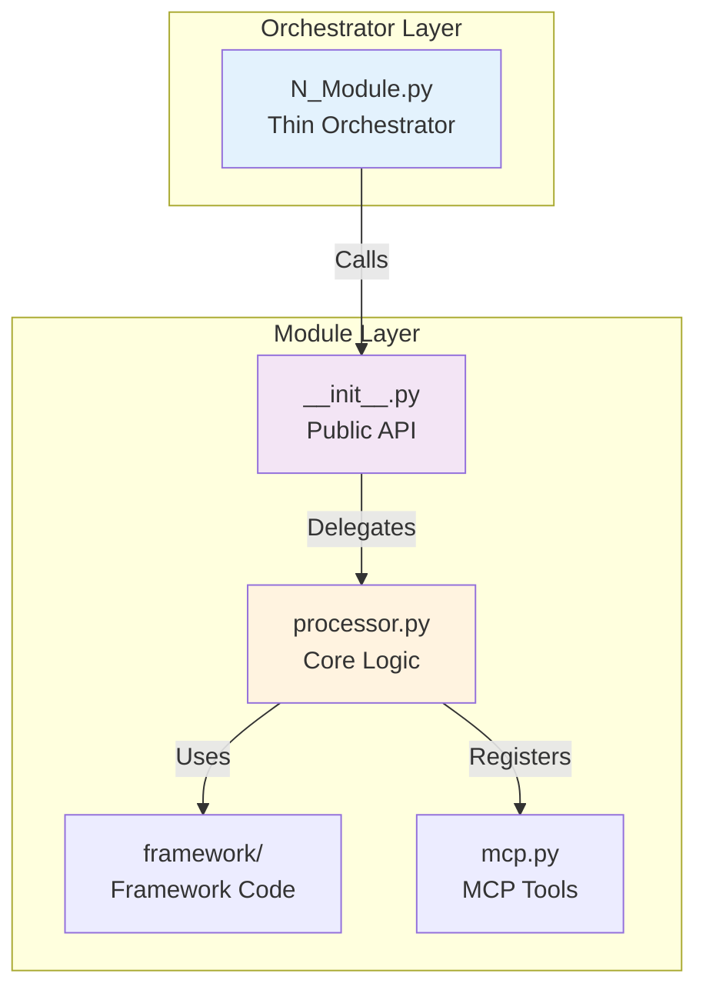

# GNN Pipeline - Master Agent Scaffolding

## Overview

The GNN (Generalized Notation Notation) Pipeline is a comprehensive 25-step system for processing Active Inference generative models. Each module follows the **thin orchestrator pattern** where numbered scripts delegate to modular implementations.

Sibling-project consumers should start with the [interoperability guide](docs/development/interop.md):
it identifies canonical typed imports, exact API and benchmark entry points,
result shapes, and the surfaces that cannot yet be shared, with integration gaps
tracked as backlog rows in [TO-DO.md](TO-DO.md).

---

## Cold Start

New to this repo as an agent? In order:

1. **What this is**: [SPEC.md](SPEC.md) + this file's Overview (25-step GNN pipeline, thin orchestrators).
2. **Exemplar spec files**: [input/gnn_files/INDEX.md](input/gnn_files/INDEX.md) — every runnable example with a selection table.
3. **Version map**: [docs/VERSION_MAP.md](docs/VERSION_MAP.md) — release history and version-sensitive surfaces.
4. **How to verify**: the canonical gate is `./run.sh gates` (`just gates`); verification commands live in [TO-DO.md](TO-DO.md); doc audits: `uv run python docs/development/docs_audit.py --strict --check-anchors --no-write`.
---

## Module Registry

### Core Processing Modules (Steps 0-9)

- **Step 0**: **[template/](src/gnn/template/AGENTS.md)** - Pipeline template and initialization
- **Step 1**: **[setup/](src/gnn/setup/AGENTS.md)** - Environment setup and dependency management
- **Step 2**: **[tests/](tests/AGENTS.md)** - Comprehensive test suite execution
- **Step 3**: **[gnn/](src/gnn/AGENTS.md)** - GNN file discovery, parsing, and multi-format serialization
- **Step 4**: **[model_registry/](src/gnn/model_registry/AGENTS.md)** - Model versioning and registry management
- **Step 5**: **[type_checker/](src/gnn/type_checker/AGENTS.md)** - Type checking and validation
- **Step 6**: **[validation/](src/gnn/validation/AGENTS.md)** - Advanced validation and consistency checking
- **Step 7**: **[export/](src/gnn/export/AGENTS.md)** - Multi-format export generation
- **Step 8**: **[visualization/](src/gnn/visualization/AGENTS.md)** - Graph and matrix visualization
- **Step 9**: **[advanced_visualization/](src/gnn/advanced_visualization/AGENTS.md)** - Advanced visualization and interactive plots

### Simulation & Analysis Modules (Steps 10-16)

- **Step 10**: **[ontology/](src/gnn/ontology/AGENTS.md)** - Active Inference ontology processing
- **Step 11**: **[render/](src/gnn/render/AGENTS.md)** - Code generation for simulation frameworks
- **Step 12**: **[execute/](src/gnn/execute/AGENTS.md)** - Execute rendered simulation scripts
- **Step 13**: **[llm/](src/gnn/llm/AGENTS.md)** - LLM-enhanced analysis and interpretation
- **Step 14**: **[ml_integration/](src/gnn/ml_integration/AGENTS.md)** - Machine learning integration
- **Step 15**: **[audio/](src/gnn/audio/AGENTS.md)** - Audio generation and sonification
- **Step 16**: **[analysis/](src/gnn/analysis/AGENTS.md)** - Advanced statistical analysis

### Integration & Output Modules (Steps 17-24)

- **Step 17**: **[integration/](src/gnn/integration/AGENTS.md)** - System integration and coordination
- **Step 18**: **[security/](src/gnn/security/AGENTS.md)** - Security validation and access control
- **Step 19**: **[research/](src/gnn/research/AGENTS.md)** - Research tools and experimental features
- **Step 20**: **[website/](src/gnn/website/AGENTS.md)** - Static HTML website generation
- **Step 21**: **[mcp/](src/gnn/mcp/AGENTS.md)** - Model Context Protocol processing
- **Step 22**: **[gui/](src/gnn/gui/AGENTS.md)** - Interactive GUI for model construction (includes gui_1, gui_2, gui_3, oxdraw)
- **Step 23**: **[report/](src/gnn/report/AGENTS.md)** - Comprehensive analysis report generation
- **Step 24**: **[intelligent_analysis/](src/gnn/intelligent_analysis/AGENTS.md)** - AI-powered pipeline analysis and executive reports

### Infrastructure Modules

- **[utils/](src/gnn/utils/AGENTS.md)** - Shared utilities and helper functions
- **[pipeline/](src/gnn/pipeline/AGENTS.md)** - Pipeline orchestration and configuration
- **[api/](src/gnn/api/AGENTS.md)** - REST API (FastAPI)
- **[cli/](src/gnn/cli/AGENTS.md)** - `gnn` CLI entry point
- **[lsp/](src/gnn/lsp/AGENTS.md)** - Language Server Protocol support
- **[audio/sapf/](src/gnn/audio/sapf/AGENTS.md)** - SAPF audio submodule (canonical home; registered via `src/gnn/audio/mcp.py`)
- **[docs/](src/gnn/doc/AGENTS.md)** - In-repo technical documentation subtree

### Run ownership and orchestration

The [pipeline module](src/gnn/pipeline/AGENTS.md) owns frozen model selection,
current-run artifacts, resumable sessions, and auditable container plans. Use
the [pipeline guide](docs/pipeline/README.md) for public execution boundaries.

### Documentation Agents

- **[gnn/](docs/gnn/AGENTS.md)** - GNN Documentation System
- **[deployment/](docs/deployment/AGENTS.md)** - Deployment Documentation

---

## Architectural Pattern

### Thin Orchestrator Design



**Numbered Scripts** (`src/gnn/N_module.py`):

- Handle argument parsing via `gnn.utils.arguments.ArgumentParser`
- Setup logging via `utils.logging.logging_utils.setup_step_logging`
- Get output directories via `pipeline.config.get_output_dir_for_script`
- Call module processing functions from `module/__init__.py`
- Return standardized exit codes (0=success, 1=error, 2=success with warnings/skipped)

**Module Implementation** (`src/gnn/<module>/`):

- Contains all domain logic in `processor.py` and subdirectories
- Provides public API via `__init__.py` exports
- Implements explicit error handling, skip statuses, and dependency diagnostics
- Registers MCP tools in `mcp.py`

### Example Structure

```
src/gnn/
├── 11_render.py              # Thin orchestrator (< 150 lines)
├── render/                   # Module implementation
│   ├── __init__.py          # Public API exports
│   ├── AGENTS.md            # This documentation
│   ├── processor.py         # Core logic
│   ├── pymdp/               # Framework-specific code
│   ├── rxinfer/
│   └── mcp.py               # MCP tool registration
```

### Function Signature Pattern

All module processing functions follow this pattern:

```python
def process_module(
    target_dir: Path, output_dir: Path, verbose: bool = False, **kwargs
) -> bool:
    """
    Main processing function for module.

    Parameters:
        target_dir: Directory containing input files
        output_dir: Directory for output files
        verbose: Enable verbose logging
        **kwargs: Additional module-specific options

    Returns:
        True if processing succeeded, False otherwise
    """
```

---

## Pipeline Execution Flow

The numbered scripts follow the [step registry](src/gnn/pipeline/step_registry.py).
The scheduler expands the requested selection using the registered prerequisites
and dispatches steps whose inputs are ready. See the
[pipeline guide](docs/pipeline/README.md#step-boundaries) for execution scope.

### Data Dependencies

Edges below describe processor-level data flow. Source consumers
receive the immutable selected-model manifest, artifact consumers receive
current-run indexes, and Steps 23/24 receive the current summary snapshot.
The [run ownership guide](docs/development/run_ownership_migration.md)
describes identity, freshness and scheduling. Current-run indexes determine
which artifacts a consumer can read. Most steps re-parse the input GNN files directly; only the edges
shown move artifacts between steps. Solid arrows are artifact reads the
consumer performs on its primary path; dotted arrows are optional enrichments
read only when the producer's output directory exists.

```mermaid
graph TD
    IN["input/ GNN files"]

    IN -->|"glob + read"| S0["Step 0: Template"]
    IN -->|"rglob + parse; producer of parsed artifacts"| S3["Step 3: GNN Parse"]
    IN -->|"glob + read"| S4["Step 4: Model Registry"]
    IN -->|"rglob + re-parse"| S5["Step 5: Type Check"]
    IN -->|"rglob + re-parse"| S10["Step 10: Ontology"]
    IN -->|"rglob + re-parse"| S11["Step 11: Render"]
    IN -->|"rglob + re-parse"| S14["Step 14: ML Integration"]
    IN -->|"glob + scan"| S18["Step 18: Security"]
    IN -->|"rglob + re-parse"| S19["Step 19: Research"]
    IN -->|"discover + read (Step 3 JSON preferred)"| S8["Step 8: Visualization"]
    IN -->|"rglob + re-parse"| S13["Step 13: LLM"]
    IN -->|"glob + re-parse"| S15["Step 15: Audio"]
    IN -->|"rglob + re-parse"| S16["Step 16: Analysis"]
    IN -->|"discover + re-parse"| S17["Step 17: Integration"]
    IN -->|"markdown starter content"| S22["Step 22: GUI"]

    S3 -->|"gnn_processing_results.json + *_parsed.json"| S6["Step 6: Validation"]
    S3 -->|"gnn_processing_results.json + *_parsed.json"| S7["Step 7: Export"]
    S3 -->|"*_parsed.json preferred; markdown fallback"| S8
    S3 -->|"manifest + *_parsed.json"| S9["Step 9: Advanced Viz"]

    S11 -->|"rendered scripts + render manifest"| S12["Step 12: Execute"]
    S12 -->|"execution results"| S16

    S10 -.->|"ontology_results.json (when present)"| S13
    S12 -.->|"execution telemetry (when present)"| S15
    S11 -.->|"render output dir (when present)"| S17
    S12 -.->|"meta-analysis (when present)"| S17

    S12 -->|"execution summary"| S20["Step 20: Website"]
    S16 -->|"analysis JSONs"| S20

    S23["Step 23: Report"]
    S23 -.->|"census of all step output dirs; viz catalog from 8/9/11/12/20"| CENSUS["output/ (every N_*_output)"]

    SUM["output/00_pipeline_summary/pipeline_execution_summary.json"]
    SUM --> S23
    SUM --> S24["Step 24: Intelligent Analysis"]
```



| Step | Runtime input source |
|------|----------------------|
| 0, 4, 5, 10, 11, 14, 18, 19 | Re-parse `input/` GNN files from the target directory |
| 1, 2, 21 | No pipeline data (environment setup, pytest run, module discovery) |
| 3 | Parses `input/` and writes parsed artifacts to `output/3_gnn_output/` |
| 6, 7, 9 | Read Step 3 artifacts from `output/3_gnn_output/` |
| 8 | Step 3 `*_parsed.json` preferred; markdown re-parse fallback |
| 12 | Step 11 rendered scripts + render manifest from `output/11_render_output/` |
| 13 | Re-parses `input/`; optionally injects `10_ontology_output/ontology_results.json` |
| 15 | Re-parses `input/`; optionally loads Step 12 execution telemetry |
| 16 | Re-parses `input/` and reads Step 12 execution results |
| 17 | Re-parses `input/`; optional meta-analysis over Step 11/12 outputs |
| 20 | Step 16 analysis JSONs, Step 12 execution summary, Step 8/9 visualization assets |
| 22 | Input markdown starter content; navigation census of step output dirs |
| 23 | Census of all 25 step output dirs plus `pipeline_execution_summary.json` |
| 24 | `output/00_pipeline_summary/pipeline_execution_summary.json` only |

Step-orchestration prerequisites (used for `--only-steps` auto-inclusion) are
declared separately in
`src/gnn/utils/pipeline_orchestration/pipeline_step_dependencies.py` and are
deliberately broader than this artifact graph.

---

## Current verification

Use exact uv 0.13.6 and the frozen development environment. The
[README runtime profiles](README.md#runtime-defaults-and-required-profiles) own
Python defaults and compatibility exceptions. The canonical gate is
`./run.sh gates` (`just gates` runs the same arm): `ruff format --check`,
`ruff check`, `mypy`, the parallel `pytest` selection under the coverage floor,
the documentation, terminology and capability-contract audits, and the v3
orchestration acceptance gate. `just release-preflight` runs the deterministic
preflight before hosted qualification;
[workflow guidance](.github/workflows/README.md) owns hosted selections and
[TO-DO.md](TO-DO.md#verification-and-execution-rules) owns verification obligations.
Use current runs for test totals, readiness and performance; historical receipts
retain the versions and source revisions actually measured.

Julia execution uses the committed environments under `src/gnn/execute/rxinfer/`
and `src/gnn/execute/activeinference_jl/`. Renderer/executor inventories come from
the live registries. Experimental cpomdp/THRML require explicit selection.
Browser, public-network, native GUI, audio-DSP and Ollama integrations retain their
explicit profiles. LLM defaults and provisioning live in the [LLM guide](docs/llm/README.md).

## Quick Start

Use the [frozen setup profile](README.md#runtime-defaults-and-required-profiles)
and start with the installed CLI:

```bash
uv run --frozen --no-sync gnn --help
uv run --frozen --no-sync gnn validate input/gnn_files/discrete/two_state_bistable.md --strict
uv run --frozen --no-sync gnn run --target-dir input/gnn_files/basics \
  --output-dir output/quickstart --only-steps 3 5 6 7 8 --skip-steps 0 1 2
```

Use the [operator quickstart](docs/quickstart.md) for execution and the
[justfile](justfile) for maintained development recipes.

## Development Guidelines

### Adding New Modules

1. Create module directory: `src/gnn/new_module/`
2. Implement `__init__.py` with public API
3. Create `AGENTS.md` documentation
4. Add numbered script: `N_new_module.py`
5. Implement tests in `tests/`
6. Add MCP tools in `mcp.py` (if applicable)

### Code Standards

- Follow thin orchestrator pattern
- Use type hints for all public functions
- Document all classes and methods
- Preserve the core coverage floor and strict >80% comprehensive native profiles
  declared in the workflows
- Keep terminal output screen-reader safe: `VisualConfig(enable_emoji=False)`
  (`src/gnn/utils/observability/visual_logging.py`) strips emoji slots, and no
  CLI flag toggles it
- Include explicit error handling, status reporting, and dependency diagnostics

---

## Testing

Use the [testing guide](docs/testing/README.md) to select the required profile.
The development environment supports focused tests and the local quality gates:

```bash
uv run --frozen --no-sync python -m pytest tests/render/ -v
./run.sh gates                 # canonical gate; `just gates` is the same arm
just quality                   # fast quality arm without the full suite
```

## Runtime defaults

Select the latest stable CPython unless a named dependency or evidence profile
requires an older runtime. The current frozen default uses Python 3.14 with
exact uv 0.13.6; the h5py/HDF5 host requirement and removal checks are documented
in README.md under Runtime defaults and required profiles. Preserve protected
producer metadata/locks and existing compatibility/native/paired rosters.
`uv.toml` mirrors all configurable uv settings from the protected pyproject.

## Cross-repo custody (FEP_Formal, GEO-INFER)

This repository uses source-bound companion checks with FEP_Formal
(`fep_formal` bridge) and GEO-INFER (interchange). Qualify the actual source pair
for a new release. The FEP bridge binds
only the declared notation contract — `pyproject.toml`, `uv.lock`,
`src/gnn/main.py`, `docs/gnn/gnn_syntax.md`,
`src/gnn/pipeline/step_registry.py` and the mirrored
`docs/other/fep_lean/bridge-contract.md`. **Edits to those contract files
re-drift the FEP custody pair** and must close through fresh bridge/Q7 and
native qualification before the final GNN companion pin; other
`src/gnn/**/*.py` implementation edits do not. The paired check is release-time
(version tags and manual dispatch), not per-pull-request. Canonical ordering and
workflow details:
[paired-revision procedure](docs/development/fep_lean_paired_revision.md).
Published tags, source archives and original proof receipts retain their
accepted identities while development continues.

## Manuscript custody (SC-22): count-changing PRs run the full ritual

`scripts/check_hydrated_prose.py` (the `Hydrated prose matches token map` step of `local-gates.yml`'s `repo-gates` job, `just hydrated-prose`) re-substitutes `manuscript/*.md` from the committed `output/data/manuscript_variables.json` and fails when the committed `output/manuscript/` differs. **Consequence: any PR that regenerates the token map (every count-changing `src/` or `tests/` PR) must run the full SC-22 ritual before it can go green.** The ritual: `python -m scripts.manuscript_build_figures` → the template's `stage_03_render` (fresh `docxology/template` clone with this repository checked out as a real directory at `projects/active/GeneralizedNotationNotation`; the template's analysis-read custody refuses a symlinked project) → `scripts/z_verify_fresh_render.py` → `scripts/z_record_manuscript_render_manifest.py` → commit `output/`. The canonical statement is the `scripts/z_generate_manuscript_variables.py` docstring.

If manuscript custody is red on main, repair main first. PR gates use the
merge-base with the target SHA; only unchanged diagnostic and exact-evidence
fingerprints may warn with the full base SHA. New or changed drift fails.
Main and scheduled audits remain strict.

## Learned User Preferences

- When implementing an attached plan, do not edit the plan file itself; use the existing to-do items and complete them without recreating them.
- Documentation fixes should verify file paths, commands, and signposts against the current repository rather than preserving stale examples.
- Prefer measured verification outputs over estimates when reporting test, pipeline, or scaling behavior.

## Learned Workspace Facts

- Pipeline `--target-dir` arguments must point to directories; single `.md` file paths are not discovered by the current `Path.rglob`-based flow.
- The PyMDP scaling study expands dense `B` tensors as O(n^3) text, so large `N` values require explicit file-size and disk-space guardrails.
- Step 12 execution runs rendered `.py` and `.jl` scripts via the execute processor; auxiliary per-framework helper scripts are not the primary pipeline path.

---

## References

- **Main Documentation**: [README.md](README.md)
- **Architecture Guide**: [ARCHITECTURE.md](ARCHITECTURE.md)
- **Pipeline Rules**: [.agent_rules](.agent_rules)

---

**Pipeline Version**: [pyproject.toml](pyproject.toml) (canonical)
**Total Steps**: 25 (0-24)
**Status**: Maintained
