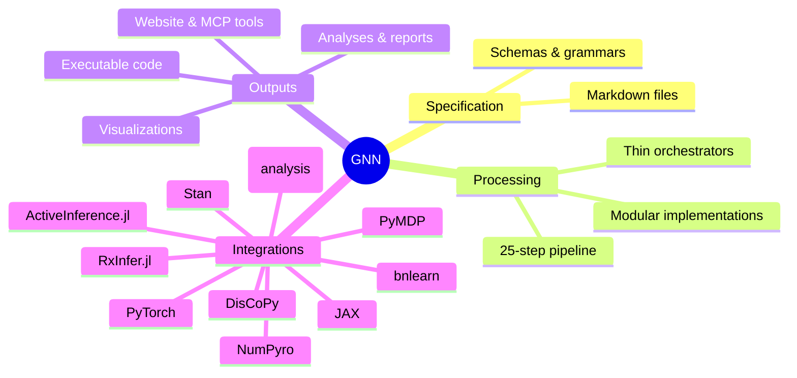
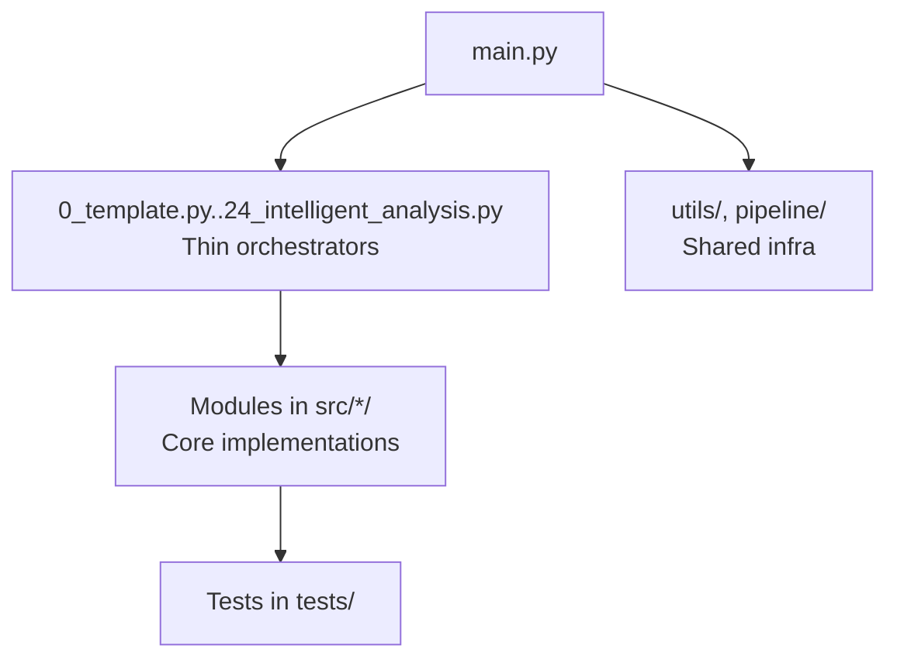
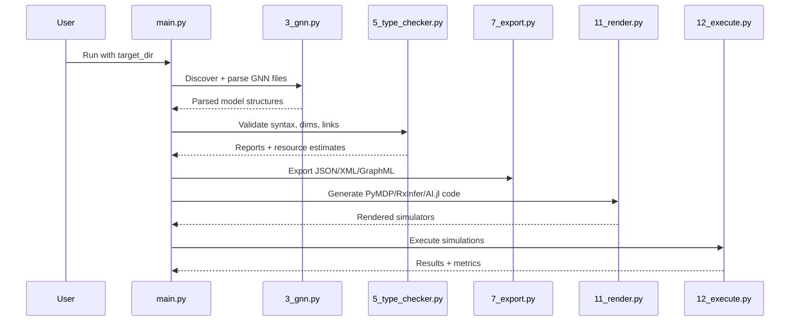
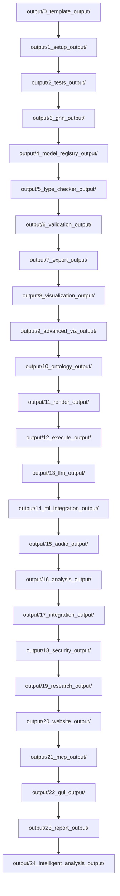
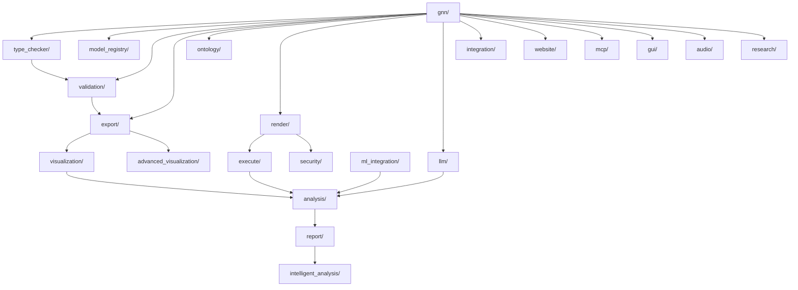
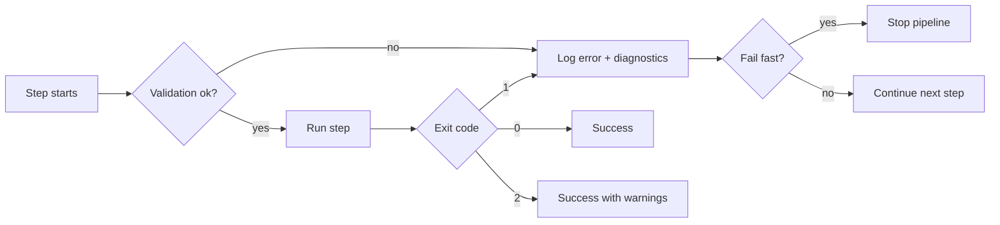

# Generalized Notation Notation (GNN) — Comprehensive Documentation

This guide maps the GNN package, pipeline, and integration points. The
[version map](docs/VERSION_MAP.md) records source releases and published assets.

## What is GNN?

- A standardized, text-based language for specifying Active Inference generative models.
- Unifies model communication across natural language, math, diagrams, and executable code.
- Enables end-to-end processing via a 25-step pipeline (0–24) from specification to simulation, analysis, GUI construction, and reporting.

## Why GNN?

- Consistent, reproducible model specification and sharing
- Interoperability across ecosystems (PyMDP, RxInfer.jl, ActiveInference.jl, JAX, DisCoPy, PyTorch, NumPyro, Stan, bnlearn)
- Traceable artifact lineage and rigorous validation
- Capability-contract checks for roadmap-visible CLI, GUI, MCP, renderer, visualization, and measured-count claims
- Developer-kit surfaces for maintained templates (`gnn templates list`, `gnn templates show`, `gnn pull`) and safe local MCP HTTP orchestration
- Model-family acceptance ledgers for broader fixture reliability and interpretability evidence

## High-Level Concept Map



## Pipeline Overview (0–24)

The diagram shows the registered step numbers. The scheduler expands the
requested steps using the [dependency table](src/gnn/utils/pipeline_orchestration/pipeline_step_dependencies.py).
See [step boundaries](docs/pipeline/README.md#step-boundaries) for run ownership
and artifact admission.

```mermaid
flowchart LR
  subgraph Pipeline (0–24)
    S0[0 Template] --> S1[1 Setup]
    S1 --> S2[2 Tests]
    S2 --> S3[3 GNN]
    S3 --> S4[4 Model Registry]
    S4 --> S5[5 Type Checker]
    S5 --> S6[6 Validation]
    S6 --> S7[7 Export]
    S7 --> S8[8 Visualization]
    S8 --> S9[9 Advanced Viz]
    S9 --> S10[10 Ontology]
    S10 --> S11[11 Render]
    S11 --> S12[12 Execute]
    S12 --> S13[13 LLM]
    S13 --> S14[14 ML Integration]
    S14 --> S15[15 Audio]
    S15 --> S16[16 Analysis]
    S16 --> S17[17 Integration]
    S17 --> S18[18 Security]
    S18 --> S19[19 Research]
    S19 --> S20[20 Website]
    S20 --> S21[21 MCP]
    S21 --> S22[22 GUI]
    S22 --> S23[23 Report]
    S23 --> S24[24 Intelligent Analysis]
  end
```

## Architecture (Thin Orchestrator Pattern)



## Data Flow From GNN Spec to Simulation

This example shows a selected workflow for an admitted model with the native
backend installed. Export is a separate output. Render and execute each
apply their own admission checks.



## Artifact Map (Outputs per Step)

This is a directory catalog in step order. An output directory can contain
historical artifacts. Current-run manifests and indexes identify the artifacts
admitted for consumption.



## Module Interaction Map



## Error Handling and Continuation

- Standard exit codes are 0=success, 1=error, 2=success with warnings/skipped.
  Strict runs treat actionable warnings as failures.
- Structured logging and correlation IDs
- Per-step graceful degradation and diagnostics



## Configuration Pointers

- Use `uv run --frozen --no-sync gnn --help` and
  `uv run --frozen --no-sync gnn run --help` from the frozen environment.
- See the [configuration guide](docs/configuration/README.md) for resolved inputs.

## Integration Notes

- PyMDP, RxInfer.jl, ActiveInference.jl, JAX, DisCoPy, PyTorch, NumPyro, Stan, bnlearn rendering configured in `src/gnn/render/` (`framework_registry.py` is the single source of the framework list)
- Execution backends in `src/gnn/execute/` (including the `stan/` cmdstanpy runner)
- Model-kind and composition admission are backend-specific. The [renderer registry](src/gnn/render/framework_registry.py) owns current support and default/experimental selection; [pipeline boundaries](docs/pipeline/README.md#step-boundaries) distinguish generator registration from native execution. See [Model Kinds and Framework Support](README.md#model-kinds-and-framework-support) for admitted scopes and limits.
- MCP tools in `src/gnn/mcp/`

## Who already uses GNN

The [downstream registry](docs/downstream/README.md) lists the repositories that
apply GNN, each with its specification path, pinned GNN revision and conformance
evidence. Read each row for its source revision and the scope of its conformance
evidence.

## References

- `.agent_rules` — canonical pipeline description (0–24)
- `src/gnn/main.py` — orchestrator implementation
- `docs/PIPELINE_SCRIPTS.md` — step details and flow
- `ARCHITECTURE.md` — implementation-oriented architecture
- `src/gnn/STEP_INDEX.md` — machine-readable step index (0–24)
- `src/gnn/mcp/audit_report.json` — machine-generated MCP tool inventory
- `src/gnn/cli/template_index.json` — packaged template index

## Machine-Readable Step Index

```json
{
  "steps": [
    {"n": 0,  "script": "0_template.py",        "module": "template",          "output": "0_template_output/"},
    {"n": 1,  "script": "1_setup.py",           "module": "setup",             "output": "1_setup_output/"},
    {"n": 2,  "script": "2_tests.py",           "module": "tests",             "output": "2_tests_output/"},
    {"n": 3,  "script": "3_gnn.py",             "module": "gnn",               "output": "3_gnn_output/"},
    {"n": 4,  "script": "4_model_registry.py",  "module": "model_registry",    "output": "4_model_registry_output/"},
    {"n": 5,  "script": "5_type_checker.py",    "module": "type_checker",      "output": "5_type_checker_output/"},
    {"n": 6,  "script": "6_validation.py",      "module": "validation",        "output": "6_validation_output/"},
    {"n": 7,  "script": "7_export.py",          "module": "export",            "output": "7_export_output/"},
    {"n": 8,  "script": "8_visualization.py",   "module": "visualization",     "output": "8_visualization_output/"},
    {"n": 9,  "script": "9_advanced_viz.py",    "module": "advanced_visualization", "output": "9_advanced_viz_output/"},
    {"n": 10, "script": "10_ontology.py",       "module": "ontology",          "output": "10_ontology_output/"},
    {"n": 11, "script": "11_render.py",         "module": "render",            "output": "11_render_output/"},
    {"n": 12, "script": "12_execute.py",        "module": "execute",           "output": "12_execute_output/"},
    {"n": 13, "script": "13_llm.py",            "module": "llm",               "output": "13_llm_output/"},
    {"n": 14, "script": "14_ml_integration.py", "module": "ml_integration",    "output": "14_ml_integration_output/"},
    {"n": 15, "script": "15_audio.py",          "module": "audio",             "output": "15_audio_output/"},
    {"n": 16, "script": "16_analysis.py",       "module": "analysis",          "output": "16_analysis_output/"},
    {"n": 17, "script": "17_integration.py",    "module": "integration",       "output": "17_integration_output/"},
    {"n": 18, "script": "18_security.py",       "module": "security",          "output": "18_security_output/"},
    {"n": 19, "script": "19_research.py",       "module": "research",          "output": "19_research_output/"},
    {"n": 20, "script": "20_website.py",        "module": "website",           "output": "20_website_output/"},
    {"n": 21, "script": "21_mcp.py",            "module": "mcp",               "output": "21_mcp_output/"},
    {"n": 22, "script": "22_gui.py",            "module": "gui",               "output": "22_gui_output/"},
    {"n": 23, "script": "23_report.py",         "module": "report",            "output": "23_report_output/"},
    {"n": 24, "script": "24_intelligent_analysis.py", "module": "intelligent_analysis", "output": "24_intelligent_analysis_output/"}
  ]
}
```

## Documentation maintenance

Run the same deterministic checks used by the
[Docs audit workflow](.github/workflows/docs-audit.yml):

```bash
uv run --frozen --no-sync python docs/development/docs_audit.py --strict --check-anchors --no-write
uv run --frozen --no-sync python scripts/check_repo_terminology.py --strict
uv run --frozen --no-sync python scripts/check_maintained_doc_terms.py --strict
```

The [development guide](docs/development/README.md) describes the maintained
scope and external-link checks.
