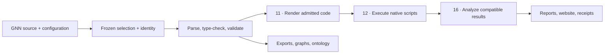

# Generalized Notation Notation (GNN)

**Describe an Active Inference generative model in Markdown, validate it, render
framework-specific code, and inspect the evidence from its execution.**

[](pyproject.toml)
[](https://github.com/ActiveInferenceInstitute/Generalized_Notation_Notation/actions/workflows/ci.yml)
[](pyproject.toml)
[](LICENSE.md)
[](https://doi.org/10.5281/zenodo.7803313)

[Quick start](#quick-start) · [Models and backends](#model-kinds-and-framework-support) ·
[Documentation](#documentation) · [Examples](#examples) ·
[Contributing](#contributing)

**Software:** 5.0.1. [Published release records](https://github.com/ActiveInferenceInstitute/Generalized_Notation_Notation/releases) own accepted tags and assets.

This major version adds replayable numerical witnesses, interactive evidence
inspection and configurable file workers. It targets coordinated FEP_Formal
2 qualification against the current scientific sources; see the
[paired release procedure](docs/development/fep_lean_paired_revision.md).
Version metadata does not establish publication or completed pairing.
**Page updated:** 2026-10-24. [Package metadata](pyproject.toml) owns the version
and dependency requirements; [CHANGELOG.md](CHANGELOG.md) owns release history.

## Overview

GNN is a human-readable, machine-parsable notation for
[Active Inference](https://activeinference.org/) generative models. This repository
provides the language, curated model sources, an installed Python package and a
25-step workflow for validation, visualization, simulation, analysis and publication.

[](#project-architecture)

*Five conceptual stages in the 25-step workflow. Backend admission depends on
the model contract; the illustration contains no measured results.*

The historical 4.2.0 release includes RxInfer 6.1 / ReactiveMP 7 support, secure aiohttp
and Pillow profiles, installed-wheel acceptance across Linux, macOS and Windows,
and independent qualification of source, native execution, manuscript and companion
custody. Read the [release notes and source-bound assets](https://github.com/ActiveInferenceInstitute/Generalized_Notation_Notation/releases/tag/v4.2.0)
for exact outcomes and limits.

### Core Design Principles

- **Readable models:** state spaces, connections, parameters, equations, time and
  ontology annotations remain inspectable in source.
- **Explicit admission:** model kind and backend contracts determine what can run.
  Unsupported models, missing dependencies, warnings and failures retain distinct outcomes.
- **Reproducible evidence:** frozen selection, source hashes, resolved configuration,
  current-run indexes and bounded execution bind artifacts to one invocation.
- **Comparable results:** numerical comparisons require compatible source identities,
  inference semantics, inputs and precision. Native Gaussian uncertainty comes from covariance.

## Key Files

| Goal | Start here |
| --- | --- |
| Run your first model | [Quick start](#quick-start), [full quickstart](docs/quickstart.md), [setup guide](SETUP_GUIDE.md) |
| Write GNN | [Language hub](docs/gnn/language/README.md), [syntax reference](docs/gnn/reference/gnn_syntax.md) |
| Choose an example | [Exemplar index](input/gnn_files/INDEX.md), [model-family manifest](input/model_family_manifest.json) |
| Understand or extend the implementation | [Architecture](ARCHITECTURE.md), [module registry](AGENTS.md), [system documentation](DOCS.md) |
| Change automation | [GitHub guide](.github/README.md), [workflow index](.github/workflows/README.md) |
| Contribute or get help | [Contributing](CONTRIBUTING.md), [support](SUPPORT.md), [security](SECURITY.md), [roadmap](TO-DO.md) |

### Directory Overview

```text
Generalized_Notation_Notation/
├── src/gnn/                 # Installed package
│   ├── main.py             # Main pipeline orchestrator
│   ├── 0_template.py … 24_intelligent_analysis.py
│   └── render/, execute/, pipeline/, cli/, …
├── tests/                   # Behavior, contract and integration tests
├── input/gnn_files/          # Curated model sources
├── input/config.yaml        # Pipeline configuration
├── docs/                    # Language, backend and operator guides
├── scripts/                 # Audits, acceptance and publication tools
├── manuscript/              # Authored manuscript sources
├── output/                  # Tracked publication evidence and provenance
├── .github/                 # Automation and GitHub-facing documentation
└── pyproject.toml, uv.lock, uv.toml
```

## Motivation and Goals

Active Inference models often spread assumptions across prose, equations, diagrams
and code. GNN keeps the specification in one inspectable text format and provides
validation, framework translation and reporting around it. A shared specification
helps researchers communicate and reproduce models; backend-specific admission
and evidence define the limits of each translation.

## Key Features

- Categorical POMDP/HMM and linear-Gaussian models, with explicit contracts for
  hierarchy, learning, precision and multi-agent compositions.
- Semantic parse/serialize preservation, shape/probability/covariance validation,
  exports, dependency graphs, ontology annotations and visualizations.
- Native backend execution, source-bound comparisons, reports and offline websites.
- CLI, REST, MCP, LSP and GUI interfaces; optional LLM, audio and ML integrations.
- Durable run manifests, reproduction checks, resumable acceptance sessions and
  auditable container plans. See [durable runs](docs/development/durable-runs.md).

### GNN Syntax Preview

Start from a [complete two-state model](input/gnn_files/discrete/two_state_bistable.md)
or a [template](docs/templates/README.md). A model declares `GNNSection`,
`GNNVersionAndFlags`, `ModelName`, `StateSpaceBlock` and `Connections`;
parameters and other sections provide the inputs required by downstream contracts.
The [syntax reference](docs/gnn/reference/gnn_syntax.md) owns the full format.

## Project Architecture

Numbered scripts are thin orchestrators: they parse arguments, configure logging
and output paths, delegate to the owning module, and return standard exit codes.
Domain logic lives under `src/gnn/`; public Python imports use `gnn.*`.



This is a conceptual workflow. [AGENTS.md](AGENTS.md) documents actual artifact
dependencies, and the [step registry](src/gnn/pipeline/step_registry.py) owns
orchestration prerequisites. Read the [v4 migration guide](docs/development/run_ownership_migration.md)
when integrating run artifacts or upgrading an earlier consumer.

### Model Kinds and Framework Support

The [renderer registry](src/gnn/render/framework_registry.py),
[executor specifications](src/gnn/execute/executor_specs.py) and
[pipeline execution discovery](src/gnn/execute/detection.py) own backend inventories
and selection. Rendering availability, model admission, installed native dependencies
and numerical acceptance are separate checks.

| Backend | Admitted scope and reference |
| --- | --- |
| [PyMDP](docs/gnn/implementations/pymdp.md), [ActiveInference.jl](docs/gnn/implementations/activeinference_jl.md) | Categorical inference and action selection under each adapter's contract |
| [JAX](docs/gnn/implementations/jax.md) | Categorical and linear-Gaussian models, with explicit scientific/composed contracts |
| [RxInfer.jl](docs/gnn/implementations/rxinfer.md) | Native Julia message passing for admitted categorical and Gaussian contracts |
| [PyTorch](docs/gnn/implementations/pytorch.md), [NumPyro](docs/gnn/implementations/numpyro.md), [Stan](docs/gnn/implementations/stan.md) | Framework-specific categorical and linear-Gaussian paths; Stan requires CmdStan |
| [DisCoPy](docs/gnn/implementations/discopy.md), [bnlearn](docs/bnlearn/README.md) | Categorical diagrams and Bayesian-network workflows |
| [ngc-learn](src/gnn/render/ngclearn/README.md) | Continuous linear-Gaussian/predictive-coding contract |
| [cpomdp](docs/gnn/implementations/cpomdp.md) | Explicit experimental selection; continuous filtering and resource-admitted finite policy enumeration |
| [THRML](docs/gnn/implementations/thrml.md) | Explicit experimental selection; strictly positive finite categorical Gibbs smoothing under fixed actions |

Composition restrictions remain backend-specific. THRML does not admit structural
zeros, coupled agents, continuous models or action search; its sample witnesses
do not establish convergence, exact inference or hardware operation. DisCoPy's
experimental Matrix route and Python 3.14 GUI callbacks remain unsupported.

`--frameworks all` selects the maintained default preset; experimental backends
require explicit selection. An `unsupported` render is not executed. A missing
optional runtime produces an unavailable/skipped result. Consult current-run
summaries before claiming that a model ran successfully.

## Processing Pipeline

The pipeline has 25 steps, numbered 0–24. See the
[step index](src/gnn/STEP_INDEX.md) for individual scripts and
[pipeline guide](docs/pipeline/README.md) for configuration and selection.

| Steps | Responsibilities |
| --- | --- |
| 0–2 | Template, environment setup and tests |
| 3–7 | Parsing, registry, type checking, validation and export |
| 8–10 | Visualization, advanced visualization and ontology |
| 11–12 | Code generation and native execution |
| 13–19 | LLM, ML, audio, analysis, integration, security and research |
| 20–24 | Website, MCP, GUI, reports and intelligent analysis |

### Running the Pipeline

After the frozen setup below, use `gnn run` or the main script:

```bash
uv run --frozen --no-sync python src/gnn/main.py --help
uv run --frozen --no-sync gnn run --help
```

`--target-dir` takes a directory; `gnn validate`, `gnn extract` and `gnn render`
take a model file. Configuration loads from `input/config.yaml`. Use dedicated
output directories and inspect `00_pipeline_summary/pipeline_execution_summary.json`.
The main-script parser also exposes `--llm-tasks` (comma-separated task names)
and `--pipeline-summary-file` (summary path); consult its help for parser defaults.
The tracked `output/` tree retains publication evidence from its recorded source;
directory presence cannot establish completion of a new run.

### CPU workers for multiple files

```bash
uv run --frozen --no-sync gnn run --only-steps 3 5 --file-workers 4
uv run --frozen --no-sync gnn run --parallel --step-workers 2 --file-workers 4
```

`--file-workers` limits CPU process workers within parsing/serialization (Step 3)
and type checking (Step 5). Each worker handles one file at a time; the parent
publishes outputs in selection order. The default is one worker. `--step-workers`
limits independent pipeline steps under `--parallel`; existing memory throttling
and the eight-step ceiling still apply. Step 12 retains its separate
`--execution-workers` option on the main-script interface. These are concurrency
limits, not CPU affinity or an operating-system CPU quota. More workers can be
slower for small files because starting processes costs time.
The file limit applies separately to each running step; concurrent steps can
each create their own pool, so the two limits are not a shared global CPU budget.

The same limits are available as `file_workers` and `step_workers` in the Python
pipeline API and the `pipeline` section of `input/config.yaml`; explicit CLI
values take precedence. Summaries record requested limits, available logical
CPUs and actual step-tier widths. Step 3/5 results record effective file-worker
limits and the PIDs that returned results. For the isolated Python 3.15
lightweight interface, use `just backend-json --workers 4 --executor process`.

## Tools and Utilities

Use the installed `gnn` entry point to inspect the available commands:

```bash
uv run --frozen --no-sync gnn --help
uv run --frozen --no-sync gnn preflight
uv run --frozen --no-sync gnn health
uv run --frozen --no-sync gnn templates list
```

| Interface | Guide |
| --- | --- |
| CLI and headless extraction | [CLI](src/gnn/cli/README.md), [extractor](src/gnn/extract/README.md) |
| REST API | [API](docs/api/README.md) |
| MCP tools and transports | [MCP](docs/mcp/README.md) |
| GUI and model editors | [GUI](src/gnn/gui/README.md) |
| LSP/editor integration | [LSP](src/gnn/lsp/README.md) |
| Complexity bounds and benchmarks | [Complexity estimator](src/gnn/type_checker/README.md) |
| Local LLM provisioning and corpus runs | [Mac local-LLM guide](docs/llm/README.md) |

`gnn serve --surface website` serves generated output; `--root` selects its
website output root and `--live-reload` injects the HTML reload poller. API
surfaces use `--surface runs`, `jobs` or `both`; see the CLI guide above.

LLM analysis is optional and advisory. The portable Ollama default remains
`smollm2:135m-instruct-q4_K_S`; use `OLLAMA_MODEL` or configuration for an explicit
profile. Runtime completion does not establish scientific answer quality.

## Quick Start

Install [uv](https://docs.astral.sh/uv/getting-started/installation/) **0.13.4**.
Commands below run from the repository root and reuse the frozen environment.

### Direct Installation

```bash
git clone https://github.com/ActiveInferenceInstitute/Generalized_Notation_Notation.git
cd Generalized_Notation_Notation
git checkout v4.3.0
uv sync --frozen --python 3.14
uv run --frozen --no-sync gnn --help
```

For development, stay on `main` instead of checking out the release tag and install the tools with
`uv sync --frozen --extra dev --python 3.14`. Add only the extras required by your
backend; see [SETUP_GUIDE.md](SETUP_GUIDE.md) for Julia, Stan, GUI and other profiles.

Validate and extract one committed model:

```bash
uv run --frozen --no-sync gnn validate input/gnn_files/discrete/two_state_bistable.md --strict
uv run --frozen --no-sync gnn extract input/gnn_files/discrete/two_state_bistable.md --compact
```

Run a small local workflow without native inference or LLM provisioning:

```bash
uv run --frozen --no-sync gnn run \
  --target-dir input/gnn_files/basics \
  --output-dir output/quickstart \
  --only-steps 3 5 6 7 8 \
  --skip-steps 0 1 2
```

Inspect the summary and generated exports/graphs under `output/quickstart`.
For native simulation, follow the [full quickstart](docs/quickstart.md), select an
admitted backend, and provision its runtime before execution.

### Runtime defaults and required profiles

GNN-owned environments use exact uv **0.13.4**. The frozen lock was refreshed
with all compatible dependency updates on 2026-10-20; the [4.2.0 release](https://github.com/ActiveInferenceInstitute/Generalized_Notation_Notation/releases/tag/v4.2.0)
records the accepted source and hosted qualification. Earlier acceptance receipts keep their original
runtime/source identities and are not renewed by editing metadata.

CPython 3.15 is outside the frozen scientific profile. This checkout selects the latest 3.14 patch
for its frozen scientific core and default `dev` group. The 3.15 probe reached
h5py 3.16.0's source build and failed because native HDF5 (`libhdf5.dylib`) was
unavailable on this macOS host; JAXlib itself installed on 3.15. The producer
range remains `>=3.11,<3.15`. This is a named build/runtime exception requiring
qualification before widening, not a general claim that Python 3.15 is unusable.

The scientific stack now admits JAX 0.12 and retains its Python-specific
PyMDP/Flax compatibility split in `pyproject.toml`. Python 3.11 resolves JAX
0.10.2, PyMDP 1.0.4 and Flax 0.12.8; newer supported Python profiles resolve
JAX 0.12.0.1, PyMDP 1.0.3 and Flax 0.12.10. ActiveInference.jl retains its
Distributions ceiling because DistributionsAD's extension fails with the newer
`@check_args` API; its committed Project documents that exception. RxInfer
resolves 6.1.0 on Julia 1.13.2. The separate FEP companion still requires its
own exact uv 0.13.0. These explicit compatibility profiles take precedence over
unqualified upgrades.

Pillow **13.0.0** is the minimum image decoder: 12.3.0 has nine October 2026
advisories. The locked Gradio **6.30.0** release declares Pillow `<13`.
The supported `uv sync --frozen --extra gui` / `--all-extras` profiles use an
explicit Pillow override in both uv configurations; native GUI, PNG and GIF
checks qualify GNN's actual consumers. Upstream Gradio metadata remains
inconsistent with this override, so generic dependency-consistency tools will
report its upper bound. Plain `pip install .` retains the secure Pillow floor;
plain `pip install '.[gui]'` / `'.[all]'` cannot resolve the upstream cap and
are unsupported. Use the committed uv profiles for those extras. Remove the
override once a released Gradio admits Pillow 13, regenerate the lock, and rerun
the native GUI/image and selected-profile security gates. The security audit
checks pinned exports without re-resolving Gradio's cap and honors the selected
interpreter/platform markers (Linux 3.14 core and 3.12 all extras in CI); it does
not claim other marker splits or suppress advisories. Historical benchmark metadata keeps the Pillow
version actually measured.

To remove the Python exception, provision/review native HDF5 and remaining build
prerequisites, qualify the exact default dependency profile on 3.15, and
review any producer-range change through the documented paired re-pin ritual.
Then run the selected source/native gates before changing the default pin.
Python 3.11/3.12/3.13 tests and the coupled `test (3.12)` required status remain
compatibility lanes. The exact native coverage, paired-revision, manuscript,
GridWorld and all-extras/GUI profiles retain their declared runtimes and evidence
contracts. This bounded default-profile check does not establish all-extras,
GUI, Docker, hosted, paired, or scientific publication acceptance.
Explicit `UV_PYTHON` selects a named compatibility/profile runtime.

For headless lightweight processing and source-bound Python 3.15 measurements,
use `just backend-json` and `just profile-backend`. These isolated standard-library
commands preserve the frozen scientific environment. See the
[profiling guide](docs/performance/python315_backend.md) for exact scope and controls.

### Need Help?

Read [troubleshooting](docs/troubleshooting/README.md), run `gnn preflight` and
`gnn health`, and inspect the current run summary. Report the exact revision,
command, environment and failure through [SUPPORT.md](SUPPORT.md).

## Documentation

| Topic | Guide |
| --- | --- |
| Documentation hub and learning paths | [docs/README.md](docs/README.md), [learning paths](docs/learning_paths.md) |
| Language and authoring | [Syntax](docs/gnn/reference/gnn_syntax.md), [tutorials](docs/gnn/tutorials/README.md) |
| Framework integration | [Integration guide](docs/gnn/integration/framework_integration_guide.md), [implementations](docs/gnn/implementations/README.md) |
| Configuration and execution | [Configuration](docs/configuration/README.md), [pipeline](docs/pipeline/README.md), [availability](docs/execution/FRAMEWORK_AVAILABILITY.md) |
| Scientific evidence and boundaries | [Validation evidence](docs/pipeline/validation_evidence_guide.md), [filesystem guarantees](docs/security/filesystem_boundaries.md) |
| Releases and archival | [Release procedure](docs/releases/README.md), [exact-version archival](docs/releases/exact_version_archival.md) |

## Examples

| Goal | Model sources |
| --- | --- |
| Learn the notation | [Basics](input/gnn_files/basics/) |
| Categorical inference and policies | [Two-state bistable model](input/gnn_files/discrete/two_state_bistable.md), [epistemic T-maze](input/gnn_files/discrete/tmaze_epistemic.md) |
| Compare native frameworks | [GridWorld](input/gnn_files/pomdp_gridworld/README.md) |
| Continuous dynamics and control | [Navigation](input/gnn_files/continuous/continuous_navigation.md), [damped oscillator](input/gnn_files/continuous/damped_oscillator_bias.md) |
| Independent Gaussian agents | [Independent-agent model](input/gnn_files/continuous/independent_gaussian_agents.md) |
| Hierarchy, learning, precision and composition | [Full exemplar index](input/gnn_files/INDEX.md), [family manifest](input/model_family_manifest.json) |
| Experimental finite smoothing | [THRML examples](input/gnn_files/thrml/README.md) |
| Cognitive modeling | [Cognitive phenomena](docs/cognitive_phenomena/README.md) |

## Repository Health

Current CI and exact-source receipts establish operational status. The
[workflow index](.github/workflows/README.md) owns triggers, Python matrices,
native selections, security checks and coverage requirements.

After frozen development setup:

```bash
just release-preflight
uv run --frozen --no-sync python scripts/check_doc_contracts.py --strict
uv run --frozen --no-sync python scripts/check_repo_terminology.py --strict
uv run --frozen --no-sync python scripts/check_maintained_doc_terms.py --strict
```

Preflight catches deterministic mistakes before expensive hosted qualification.
The ordinary test matrix covers Python 3.11–3.14. Core coverage retains its 60%
floor; comprehensive native coverage requires strictly more than 80% independently
on each declared interpreter. Native, installed-platform, all-extras, manuscript
and paired-custody evidence retain their own environments and acceptance scopes.
The [release procedure](docs/releases/README.md#repeatable-release-qualification)
collects exact commit/run/attempt/job identities across all sixteen workflows.

Use [tests/README.md](tests/README.md) for test selection and
[TO-DO.md](TO-DO.md#verification-and-execution-rules) for verification obligations.

## Contributing

Start with [CONTRIBUTING.md](CONTRIBUTING.md), [AGENTS.md](AGENTS.md) and the
[roadmap](TO-DO.md). Keep changes focused, commands runnable, and evidence tied
to the source it describes. Source-bound manuscript or companion inputs require
their documented producer and re-pin procedures.

- [Issues](https://github.com/ActiveInferenceInstitute/Generalized_Notation_Notation/issues): reproducible bugs and scoped improvements.
- [Discussions](https://github.com/ActiveInferenceInstitute/Generalized_Notation_Notation/discussions): modeling questions and ideas.
- [Security policy](SECURITY.md): vulnerability reporting.
- [Code of conduct](CODE_OF_CONDUCT.md): participation standards.

## Release artifacts and citation

[Release records](https://github.com/ActiveInferenceInstitute/Generalized_Notation_Notation/releases)
provide accepted version tags and downloadable source-bound artifacts. The
[4.3.0 changelog](CHANGELOG.md#430---2026-10-21) describes independent
source-bound numerical witnesses and earlier CI documentation checks. The
[E4 contract](docs/development/remaining_roadmap_contracts.md#e4-foundation-source-bound-numerical-witness-v1)
states the exact finite/Gaussian scope and its limits; the
[current delivery priorities](TO-DO.md#current-delivery-priorities) owns remaining work.

[GNN 4.2.1](https://github.com/ActiveInferenceInstitute/Generalized_Notation_Notation/releases/tag/v4.2.1)
provides the ordinary wheel/sdist, manuscript PDF, overview image, source binding,
verification records and checksums. Main can contain later documentation changes;
released artifacts retain their original tag/source identities.

For academic use, follow [CITATION.cff](CITATION.cff). The initial publication is
Smékal, J., & Friedman, D. A. (2023), *Generalized Notation Notation for Active
Inference Models*, Active Inference Journal. The
[project concept DOI](https://doi.org/10.5281/zenodo.7803313) identifies the project;
exact-version source and distribution archival are separate acceptance steps.
See [archival guidance](docs/releases/exact_version_archival.md) and
[release history](CHANGELOG.md) for historical records.

## License

GNN is maintained by the [Active Inference Institute](https://activeinference.org/)
community under [CC BY-NC-SA 4.0](LICENSE.md). Attribution, noncommercial use and
share-alike terms apply; consult the license for the full terms.
