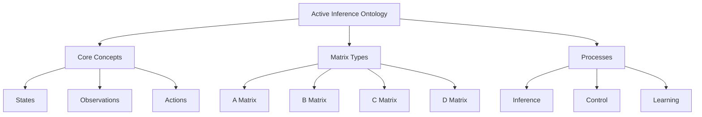
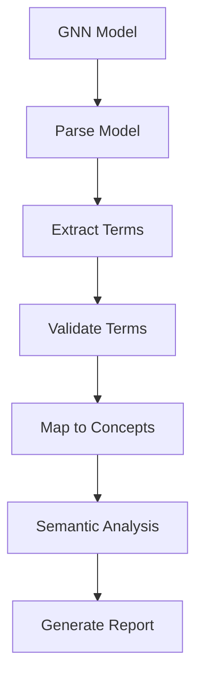

# GNN Ontology Guide

**Version**: v3.2.0 Engine (Bundle v2.0.0)  
**Last Updated**: 2026-11-01  
**Modules**: 38+ · **Pipeline steps**: 25 · **Renderers**: registry-defined backends (see [../implementations/README.md](../implementations/README.md)) · **Tests**: see [../../../README.md](../../../README.md)

This document provides comprehensive guidance on ontology processing for Generalized Notation Notation (GNN) models, including Active Inference ontology integration, term mapping, and semantic validation.

> [!TIP]
> For concrete JSON examples, file paths, and quick-start commands, see [Ontology System Documentation](ontology_system.md). This guide focuses on the programmatic API and processing workflow.

## Overview

Ontology processing enables semantic validation and term mapping for GNN models against the Active Inference Ontology. This ensures models use standardized terminology and maintain semantic consistency with Active Inference theory.

The GNN ontology system provides:

- **Term Extraction**: Automatic extraction of ontology terms from GNN models
- **Ontology Validation**: Validation against Active Inference Ontology
- **Term Mapping**: Mapping GNN components to ontological concepts
- **Semantic Analysis**: Semantic relationship analysis and validation

## Ontology Pipeline Integration

GNN ontology processing is integrated into the 25-step processing pipeline:

**Step 10: Ontology** (`10_ontology.py`)

- Ontology term extraction and validation
- Semantic mapping and analysis
- See: [src/gnn/ontology/AGENTS.md](../../../src/gnn/ontology/AGENTS.md)

**Quick Start:**

```bash
# Process ontology validation
uv run python src/gnn/main.py --only-steps "3,10" --target-dir input/gnn_files --verbose

# Run ontology step directly
uv run python src/gnn/10_ontology.py --target-dir input/gnn_files --output-dir output --verbose
```

## Active Inference Ontology

The Active Inference Ontology provides standardized terminology for Active Inference concepts:

### Core Concepts

- **States**: Hidden states, observations, actions
- **Matrices**: A, B, C, D matrices and their meanings
- **Inference**: Variational inference, belief updating
- **Control**: Policy selection, action selection
- **Learning**: Parameter learning, model adaptation

### Ontology Structure

The ontology is organized hierarchically:



## Ontology Processing

### Term Extraction

The ontology system automatically extracts terms from GNN models:

```python
from gnn.ontology import parse_gnn_ontology_section

# Parse ontology annotations from GNN file content
with open("input/gnn_files/model.md") as f:
    content = f.read()
result = parse_gnn_ontology_section(content)

# Returns dict with:
# - concepts: [str, ...]        (from "Concept:"/"Concepts:" lines)
# - relations: [str, ...]       (from "Relation:"/"Relations:" lines)
# - properties: [str, ...]      (from "Property:"/"Properties:" lines)
# - annotations: [str, ...]     (KEY=VALUE lines, e.g. "A=LikelihoodMatrix")
```

### Ontology Validation

Validate extracted terms against the Active Inference Ontology:

```python
from gnn.ontology import validate_annotations, load_defined_ontology_terms

# Load the declared vocabulary (64 labels: descriptions plus declared obo: metadata)
ontology_terms = load_defined_ontology_terms()

# Validate annotations against the declared vocabulary and resolve the matched
# labels through the pinned vocabulary bridge
result = validate_annotations(
    annotations=["A=LikelihoodMatrix", "s=HiddenState", "x=InvalidTerm"],
    ontology_terms=ontology_terms,
)
# result includes:
# - valid_annotations: [str, ...]      (annotations that matched a declared term)
# - invalid_annotations: [str, ...]    (annotations with no matching term)
# - matched_terms: {key: {annotation, term_name, description, ontology_id,
#                         ontology_status, ontology_term, ontology_reason, key,
#                         value, comment}}
# - suggestions: [{annotation, suggested_term, description}]
# - coverage_score: float              (valid / total)
# - ontology_identifier_counts: {resolved, unresolved, not_declared, bridge_unavailable}
```

### Ontology Identifiers

Ontology identifiers for annotations come from the Active Inference Ontology's
generated vocabulary bridge, pinned into this repository:

- **Copy:** `src/gnn/ontology/active_inference_ontology_terms.json` — schema `active-inference-ontology/gnn-terms/v1`, release v5 (2023-05-25), 429 terms, 64 declared labels.
- **Pin:** `src/gnn/ontology/ontology-pin.json` — source repository, commit, release, path, the copy SHA-256, and the bridge's embedded source/export digests and counts.
- **API:** `gnn.ontology.bridge` exposes `load_ontology_bridge`, `load_ontology_pin`, `verify_ontology_pin`, `ontology_bridge_status`, `declared_label_index`, `resolve_declared_label` and `pinned_declared_index`; `resolve_declared_label(label, declared)` returns a `DeclaredResolution` with `status`, `identifier`, `ontology_term` and `reason`.
- **Freshness gate:** `uv run --frozen --no-sync python scripts/check_ontology_pin.py` re-verifies the copy against the pin and fails when they disagree (`--json` prints the same verdict as JSON).

The `obo:ACTO_*` / `obo:TEMP_*` values in the vocabulary file are declared
metadata. No `ACTO` ontology is registered in the OBO Foundry, Bioregistry or
OLS4, and `http://purl.obolibrary.org/obo/ACTO_000001` returns HTTP 404, so they
are never emitted as identifiers.

### Term Mapping

Generate mapping between GNN model components and ontology concepts:

```python
from gnn.ontology import process_gnn_ontology

# Process ontology for a single GNN file (parse + validate + report)
result = process_gnn_ontology("input/gnn_files/model.md")
# Returns:
# - success: bool
# - file_path: str
# - ontology_data: dict          (from parse_gnn_ontology_section)
# - validation_result: dict      (from validate_annotations)
# - ontology_terms: dict         (from load_defined_ontology_terms)
```

## Ontology Processing Workflow

The ontology processing workflow:



## Semantic Validation

Semantic validation ensures GNN models maintain semantic consistency:

### Validation Levels

- **Strict Validation**: All terms must be in ontology
- **Relaxed Validation**: Suggestions for invalid terms
- **Semantic Analysis**: Deep semantic relationship analysis

### Validation Features

- **Term Recognition**: Automatic term recognition
- **Concept Mapping**: Mapping to ontological concepts
- **Relationship Validation**: Validation of semantic relationships
- **Consistency Checking**: Cross-reference consistency validation

## Ontology Enhancement

The ontology system provides enhancement suggestions:

### Enhancement Types

- **Term Suggestions**: Suggested ontology terms for invalid terms
- **Concept Refinement**: Refinement suggestions for concepts
- **Relationship Suggestions**: Suggested semantic relationships
- **Structure Improvements**: Model structure improvement suggestions

## Integration with Pipeline

Ontology processing integrates throughout the pipeline:

1. **Core Processing** (Steps 0-9): Ontology term extraction during parsing
2. **Simulation** (Steps 10-16): Ontology validation during execution
3. **Integration** (Steps 17-24): Ontology results in comprehensive outputs

## Best Practices

### Ontology Usage

- **Standard Terminology**: Use standardized Active Inference terminology
- **Term Consistency**: Maintain consistent term usage across models
- **Semantic Validation**: Validate models against ontology
- **Enhancement Application**: Apply ontology enhancement suggestions

### Model Development

- **Early Validation**: Validate ontology early in model development
- **Verbose Mode**: Use `--verbose` for detailed validation output
- **Documentation**: Document ontology term usage
- **Consistency**: Maintain consistency with Active Inference theory

## Related Documentation

- **[Ontology Module](../../../src/gnn/ontology/AGENTS.md)**: Implementation details
- **[Active Inference Ontology](ontology_system.md)**: In-repo ontology documentation
- **[GNN Tools](../operations/gnn_tools.md)**: Complete GNN tools reference
- **[GNN Standards](../reference/gnn_standards.md)**: GNN domain knowledge and standards

## See Also

- **[Pipeline Documentation](../operations/gnn_tools.md)**: Complete pipeline guide
- **[GNN Overview](../gnn_overview.md)**: Core GNN concepts
- **[Advanced Modeling Patterns](advanced_modeling_patterns.md)**: Advanced modeling techniques

---

**Last Updated**: 2026-11-01  
**Version**: v3.2.0 Engine (Bundle v2.0.0)
