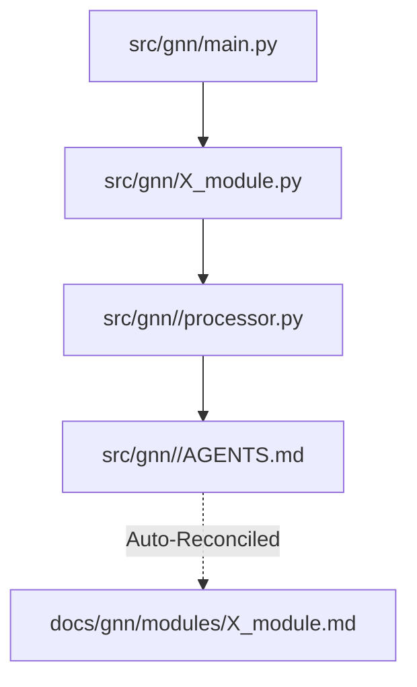

# GNN Modules Sub-Tree

**Package version**: [pyproject.toml](../../../pyproject.toml) (canonical)
**Documentation bundle**: [docs/gnn/README.md](../README.md)
**Status**: Production Documentation Synchronization

This directory contains autogenerated mappings of the real internal codebase orchestration loops (`00-24`). These docs describe the per-step orchestration loops; capabilities are documented per step below. 
Each file listed corresponds identically to a step within the overarching GNN execution pipeline, automatically extracting Agent configurations and logic layers directly from `src/*/AGENTS.md`.

## Indices Map
- `00_template.md` -> `src/gnn/0_template.py` 
- `01_setup.md` -> `src/gnn/1_setup.py`
...
- `24_intelligent_analysis.md` -> `src/gnn/24_intelligent_analysis.py`

## Architecture
The GNN Pipeline strictly aligns all modules utilizing the "Thin Orchestrator" pattern. 

## Documents in this folder

- [`main.py` — Pipeline Orchestrator](main.md)
- [Module Agent Sync Maps](AGENTS.md) — per-step module index
- [Init Modules Index](init.md)
