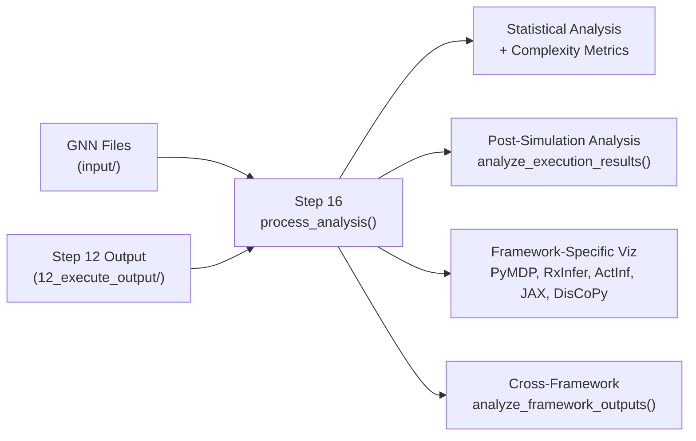

# GNN Technical Reference

**Version**: v3.2.0 Engine (Bundle v2.0.0)  
**Last Updated**: 2026-04-15  
**Status**: Maintained
**Scope**: Technical reference for parser, pipeline, and renderer behavior. See [framework implementations](../implementations/README.md) for target-specific detail.

Comprehensive reference for GNN processing pipeline implementation.

## Complete Pipeline Entry Points (Steps 0-24)

All pipeline steps follow the thin orchestrator pattern. Each step is documented in its module's AGENTS.md:

### Core Processing (0-9)

- `0_template.py` → `src/gnn/template/AGENTS.md`
- `1_setup.py` → `src/gnn/setup/AGENTS.md`
- `2_tests.py` → `tests/AGENTS.md`
- `3_gnn.py` → `src/gnn/AGENTS.md`
- `4_model_registry.py` → `src/gnn/model_registry/AGENTS.md`
- `5_type_checker.py` → `src/gnn/type_checker/AGENTS.md`
- `6_validation.py` → `src/gnn/validation/AGENTS.md`
- `7_export.py` → `src/gnn/export/AGENTS.md`
- `8_visualization.py` → `src/gnn/visualization/AGENTS.md`
- `9_advanced_viz.py` → `src/gnn/advanced_visualization/AGENTS.md`

### Simulation & Analysis (10-16)

- `10_ontology.py` → `src/gnn/ontology/AGENTS.md`
- `11_render.py` → `src/gnn/render/AGENTS.md`
- `12_execute.py` → `src/gnn/execute/AGENTS.md`
- `13_llm.py` → `src/gnn/llm/AGENTS.md`
- `14_ml_integration.py` → `src/gnn/ml_integration/AGENTS.md`
- `15_audio.py` → `src/gnn/audio/AGENTS.md`
- `16_analysis.py` → `src/gnn/analysis/AGENTS.md`

### Integration & Output (17-24)

- `17_integration.py` → `src/gnn/integration/AGENTS.md`
- `18_security.py` → `src/gnn/security/AGENTS.md`
- `19_research.py` → `src/gnn/research/AGENTS.md`
- `20_website.py` → `src/gnn/website/AGENTS.md`
- `21_mcp.py` → `src/gnn/mcp/AGENTS.md`
- `22_gui.py` → `src/gnn/gui/AGENTS.md`
- `23_report.py` → `src/gnn/report/AGENTS.md`
- `24_intelligent_analysis.py` → `src/gnn/intelligent_analysis/AGENTS.md`

### Main Documentation

- **[src/gnn/AGENTS.md](../../../src/gnn/AGENTS.md)**: Master agent scaffolding and module registry
- **[src/gnn/README.md](../../../src/gnn/README.md)**: Pipeline architecture and safety patterns
- **[src/gnn/main.py](../../../src/gnn/main.py)**: Pipeline orchestrator implementation

---

## Round-Trip Data Flow (Actual Implementation)

### Stage 1: GNN → Parsed JSON (Step 3)

**Entry Point:** `src/gnn/3_gnn.py:main()` → `src/gnn/processing/multi_format_processor.py:process_gnn_multi_format()`

**Key Parsing Patterns:**

```python
# src/gnn/schema_validator/syntax.py:58-63 (actual regex patterns)
SECTION_PATTERN = re.compile(r"^## (.+)$")
VARIABLE_PATTERN = re.compile(
    r"^([\w_π][\w\d_π]*)(\[([^\]]+)\])?(?:,type=([a-zA-Z]+))?(?:\s*#\s*(.*))?$"
)
CONNECTION_PATTERN = re.compile(r"^(.+?)\s*(>|->|-|\|)\s*(.+?)(?:\s*#\s*(.*))?$")
PARAMETER_PATTERN = re.compile(r"^([\w_π][\w\d_π]*)(\s*[:=]\s*)(.+?)(?:\s*#\s*(.*))?$")
```

**Input:** `input/gnn_files/actinf_pomdp_agent.md`

```gnn
## StateSpaceBlock
A[3,3,type=float]           # Likelihood matrix
B[3,3,3,type=float]         # Transition matrix
C[3,type=float]             # Preference vector

## Connections  
D>s                         # Prior causes state
s-A                         # State relates to likelihood
A-o                         # Likelihood relates to observation
```

**Output:** `output/3_gnn_output/Classic Active Inference POMDP Agent v1/actinf_pomdp_agent_parsed.json`

```json
{
  "model_name": "Classic Active Inference POMDP Agent v1",
  "variables": [
    {"name": "A", "dimensions": [3,3], "type": "float", "description": "Likelihood matrix"},
    {"name": "B", "dimensions": [3,3,3], "type": "float", "description": "Transition matrix"},
    {"name": "C", "dimensions": [3], "type": "float", "description": "Preference vector"}
  ],
  "connections": [
    {"source": ["D"], "target": ["s"], "type": "directed", "description": "Prior causes state"},
    {"source": ["s"], "target": ["A"], "type": "undirected", "description": "State relates to likelihood"}
  ],
  "sections": {
    "StateSpaceBlock": ["A", "B", "C"],
    "Connections": ["D>s", "s-A", "A-o"]
  }
}
```

### Stage 2: Type Analysis (Step 5)  

**Entry Point:** `src/gnn/5_type_checker.py:main()` → `src/gnn/type_checker/checking/core.py:GNNTypeChecker`

**Core Analysis Method:** (lines 13-62 in analysis_utils.py)

```python
def analyze_variable_types(variables: List[Dict[str, Any]]) -> Dict[str, Any]:
    type_analysis = {
        "total_variables": len(variables),
        "type_distribution": {},
        "dimension_analysis": {
            "max_dimensions": 0,
            "avg_dimensions": 0,
            "dimension_distribution": {},
        },
        "complexity_metrics": {
            "total_elements": 0,
            "estimated_memory_bytes": 0,
        },
    }
    # ... (actual implementation details)
```

**Output:** `output/5_type_checker_output/type_check_results.json`

```json
{
  "type_analysis": {
    "total_variables": 7,
    "type_distribution": {"float": 5, "int": 2},
    "dimension_analysis": {
      "max_dimensions": 3,
      "dimension_distribution": {"1D": 3, "2D": 1, "3D": 3}
    },
    "complexity_metrics": {
      "total_elements": 57,
      "estimated_memory_mb": 0.45
    }
  }
}
```

### Stage 3: Multi-format Export (Step 7)

**Entry Point:** `src/gnn/7_export.py:process_export()` → `src/gnn/export/`

**Framework Targets:**

- **GraphML**: Network analysis tools (Gephi, Cytoscape)
- **GEXF**: Graph visualization (Sigma.js, Gephi)  
- **XML**: Generic data interchange
- **Pickle**: Python object serialization
- **JSON**: Web applications and APIs

### Stage 4: Code Generation (Step 11)

**Entry Point:** `src/gnn/11_render.py:main()` → `src/gnn/render:process_render()`

**Framework Integration Points:**

#### PyMDP Framework

```python
# Generated: output/11_render_output/actinf_pomdp_agent_pymdp.py
import pymdp
import numpy as np

# Matrices extracted from GNN specification
A = np.array([[0.9, 0.05, 0.05], [0.05, 0.9, 0.05], [0.05, 0.05, 0.9]])
B = np.array(
    [
        [[1.0, 0.0, 0.0], [0.0, 1.0, 0.0], [0.0, 0.0, 1.0]],  # Action 0
        [[0.0, 1.0, 0.0], [1.0, 0.0, 0.0], [0.0, 0.0, 1.0]],  # Action 1
        [[0.0, 0.0, 1.0], [0.0, 1.0, 0.0], [1.0, 0.0, 0.0]],  # Action 2
    ]
)
C = np.log([0.1, 0.1, 1.0])  # Log-preferences
D = np.array([0.33333, 0.33333, 0.33333])  # Prior
E = np.array([0.33333, 0.33333, 0.33333])  # Habit

agent = pymdp.Agent(A=A, B=B, C=C, D=D, E=E)
```

#### RxInfer.jl Framework  

```julia
# Generated: output/11_render_output/actinf_pomdp_agent_rxinfer.jl
using RxInfer, LinearAlgebra

@model function actinf_pomdp_agent()
    # Matrices from GNN specification
    A ~ MatrixDirichlet(ones(3,3))
    B ~ MatrixDirichlet(ones(3,3,3)) 
    C ~ Dirichlet(ones(3))
    
    # State evolution
    s[1] ~ Categorical(D)
    for t in 2:T
        s[t] ~ Categorical(B[:, s[t-1], u[t-1]])
    end
    
    # Observations
    for t in 1:T
        o[t] ~ Categorical(A[:, s[t]])
    end
end
```

#### ActiveInference.jl Framework

```julia
# Generated: output/11_render_output/actinf_pomdp_agent_ai.jl
using ActiveInference

# Define POMDP from GNN matrices
pomdp = POMDP(
    A = [0.9 0.05 0.05; 0.05 0.9 0.05; 0.05 0.05 0.9],
    B = cat([1.0 0.0 0.0; 0.0 1.0 0.0; 0.0 0.0 1.0],
            [0.0 1.0 0.0; 1.0 0.0 0.0; 0.0 0.0 1.0], 
            [0.0 0.0 1.0; 0.0 1.0 0.0; 1.0 0.0 0.0], dims=3),
    C = log.([0.1, 0.1, 1.0]),
    D = [0.33333, 0.33333, 0.33333]
)

agent = ActiveInferenceAgent(pomdp)
```

### Stage 5: Execution (Step 12)

**Entry Point:** `src/gnn/12_execute.py:main()` → `src/gnn/execute:process_execute()`

**Execution Results:** `output/12_execute_output/execution_results.json`

Illustrative shape with invented values — not a captured run. The
authoritative RxInfer payload schema is `rxinfer_simulation_v1`, documented in
[`src/gnn/render/rxinfer/README.md`](../../../src/gnn/render/rxinfer/README.md):

```json
{
  "pymdp_execution": {
    "status": "success",
    "timesteps": 100,
    "final_free_energy": -2.34,
    "execution_time_ms": 847,
    "memory_peak_mb": 45.2
  },
  "rxinfer_execution": {
    "status": "success", 
    "inference_iterations": 10,
    "final_elbo": 156.7,
    "execution_time_ms": 1230
  }
}
```

## Cross-References and Dependencies

### Data Flow Dependencies

```
Step 3 (GNN) → output/3_gnn_output/ (manifest + per-model parsed JSON)
├── Step 6 (Validation) ← manifest + parsed JSON
├── Step 7 (Export) ← manifest + parsed JSON
├── Step 8 (Visualization) ← parsed JSON (markdown re-parse fallback)
└── Step 9 (Advanced Viz) ← manifest + parsed JSON

Step 11 (Render) → output/11_render_output/ (rendered scripts + manifest)
└── Step 12 (Execute) ← rendered scripts + manifest

Step 12 (Execute) → output/12_execute_output/
└── Step 16 (Analysis) ← execution results; Step 20 (Website) ← execution summary

Step 16 (Analysis) → output/16_analysis_output/
└── Step 20 (Website) ← analysis JSONs

output/00_pipeline_summary/pipeline_execution_summary.json
├── Step 23 (Report) ← summary + census of all step output dirs
└── Step 24 (Intelligent Analysis) ← summary only
```

Steps 5, 10, 11, 13, and 14 re-parse the target-dir GNN files directly (no Step 3 artifacts); optional enrichments: 10 → 13, 12 → 15, 11/12 → 17.

### Module Cross-References

#### Parsing System

- **Main Interface:** `src/gnn/processing/multi_format_processor.py`
- **Schema Validation:** `src/gnn/schema_validator/syntax.py:GNNParser` (line 54)
- **Multi-format Support:** `src/gnn/parsers/` directory
  - `markdown_parser.py`: Standard GNN markdown format
  - `python_parser.py`: Neural network implementations (line 25)
  - `lean_parser.py`: Category theory proofs  
  - `protobuf_parser.py`: Binary protocol buffers

#### Visualization System  

- **Core Visualizer:** `src/gnn/visualization/visualizer.py:GNNVisualizer` (line 66)
- **Matrix Processing:** `src/gnn/visualization/processor.py`
  - `parse_matrix_data()` (line 367)
  - `generate_matrix_visualizations()` (line 403)
  - `generate_network_visualizations()` (line 523)
- **Safe Import Pattern:** `src/gnn/visualization/__init__.py` (line 15-47)

#### Type Analysis System

- **Core Analysis:** `src/gnn/type_checker/analysis_utils.py:analyze_variable_types()` (line 13)
- **Validation Logic:** `src/gnn/type_checker/checking/core.py:GNNTypeChecker` (line 111)
- **Processing Pipeline:** `src/gnn/type_checker/processor.py` (line 20)

## Framework Integration Validation

### Round-Trip Validation (Step 6)

**Implementation:** `src/gnn/6_validation.py:main()` → `src/gnn/validation:process_validation()`

The sketch below is **illustrative pseudocode** for the round-trip property,
not a function that exists under that name:

```python
# Illustrative — not a real symbol
def validate_round_trip(original_gnn, exported_formats):
    # 1. Parse original GNN
    parsed_original = parse_gnn(original_gnn)

    # 2. Export to each format
    for format_name, format_data in exported_formats.items():
        # 3. Re-import from format
        reimported = import_format(format_data, format_name)

        # 4. Validate semantic equivalence
        assert semantic_equivalent(parsed_original, reimported)
        assert matrix_dimensions_match(parsed_original, reimported)
        assert connection_topology_preserved(parsed_original, reimported)
```

### Framework Code Validation

**PyMDP Validation:**

```python
# Validate generated PyMDP code compiles and runs
exec(compile(open("actinf_pomdp_agent_pymdp.py").read(), "generated", "exec"))
assert agent.A.shape == (3, 3)
assert agent.B.shape == (3, 3, 3)
```

**RxInfer.jl Validation:**  

```julia
# Validate generated Julia code syntax
include("actinf_pomdp_agent_rxinfer.jl")
model = actinf_pomdp_agent()
@assert typeof(model) <: RxInfer.Model
```

## Performance Characteristics

Complexity classes below are derived from the algorithms. The absolute
throughput and memory figures are **rough order-of-magnitude estimates, not
benchmark results** — no committed benchmark artifact produces them. Use
`just bench` for measured numbers.

### Parsing Performance (Step 3)

- **Markdown GNN:** order ~50KB/s sustained throughput (estimate)
- **Multi-format Detection:** order <10ms per file (estimate)
- **Memory Usage:** order ~2MB per 1000 variables (estimate)

### Visualization Performance (Step 8)

- **Matrix Generation:** O(n²) for n×n matrices  
- **Network Layout:** O(n log n) for n nodes
- **Memory Usage:** order ~15MB for 100×100 matrices (estimate)

### Type Analysis Performance (Step 5)

- **Variable Analysis:** O(n) for n variables
- **Connection Analysis:** O(m) for m connections
- **Complexity Estimation:** O(n×m) combined analysis

## Stage 6: Post-Simulation Analysis (Step 16)

### Entry Point and Module Delegation

**Orchestrator:** `src/gnn/16_analysis.py` → `src/gnn/analysis/processor.py:process_analysis()`

The analysis step consumes outputs from both the GNN source files and the execution results directory (`output/12_execute_output/`).

### Data Flow Dependencies



### Key Analysis Functions

| Function | Module | Signature |
|----------|--------|-----------|
| `process_analysis` | `analysis.processor` | `(target_dir, output_dir, verbose, **kwargs) → bool` |
| `perform_statistical_analysis` | `analysis.analyzer` | `(gnn_file, verbose) → dict` |
| `calculate_complexity_metrics` | `analysis.analyzer` | `(gnn_file, verbose) → dict` |
| `run_performance_benchmarks` | `analysis.analyzer` | `(gnn_file, verbose) → dict` |
| `analyze_execution_results` | `analysis.post_simulation` | `(execution_results_dir, model_name) → dict` |
| `analyze_active_inference_metrics` | `analysis.post_simulation` | `(beliefs, free_energy, actions, model_name) → dict` |
| `visualize_all_framework_outputs` | `analysis.post_simulation` | `(execution_dir, output_dir, logger) → list` |
| `generate_unified_framework_dashboard` | `analysis.post_simulation` | `(framework_data, output_dir, model_name) → list` |

### Output Format

```
output/16_analysis_output/
├── analysis_results.json               # Machine-readable results
├── analysis_summary.md                 # Human-readable summary
├── {model}_post_simulation_analysis.json
├── pymdp/                              # PyMDP visualizations
├── activeinference_jl/                 # ActiveInference.jl visualizations
├── discopy/                            # DisCoPy visualizations
├── jax/                                # JAX visualizations
├── rxinfer/                            # RxInfer visualizations
└── cross_framework/                    # Cross-framework comparisons
    └── unified_dashboard/
```

### Analysis Performance (Step 16)

- **Statistical Analysis:** O(n) for n GNN files
- **Post-Simulation Loading:** File I/O bound (~10ms per JSON result file)
- **Active Inference Metrics:** O(T×S) for T timesteps and S states per metric
- **Cross-Framework Comparison:** O(F×T) for F frameworks and T timesteps
- **Visualization Generation:** order ~200ms per plot, Matplotlib Agg backend (estimate)

This reference documents implementation structure — module paths, entry
points, and data flow — verified against the source tree. Timing and memory
figures are estimates and are labelled as such; treat measured numbers as
coming from `just bench` only.
