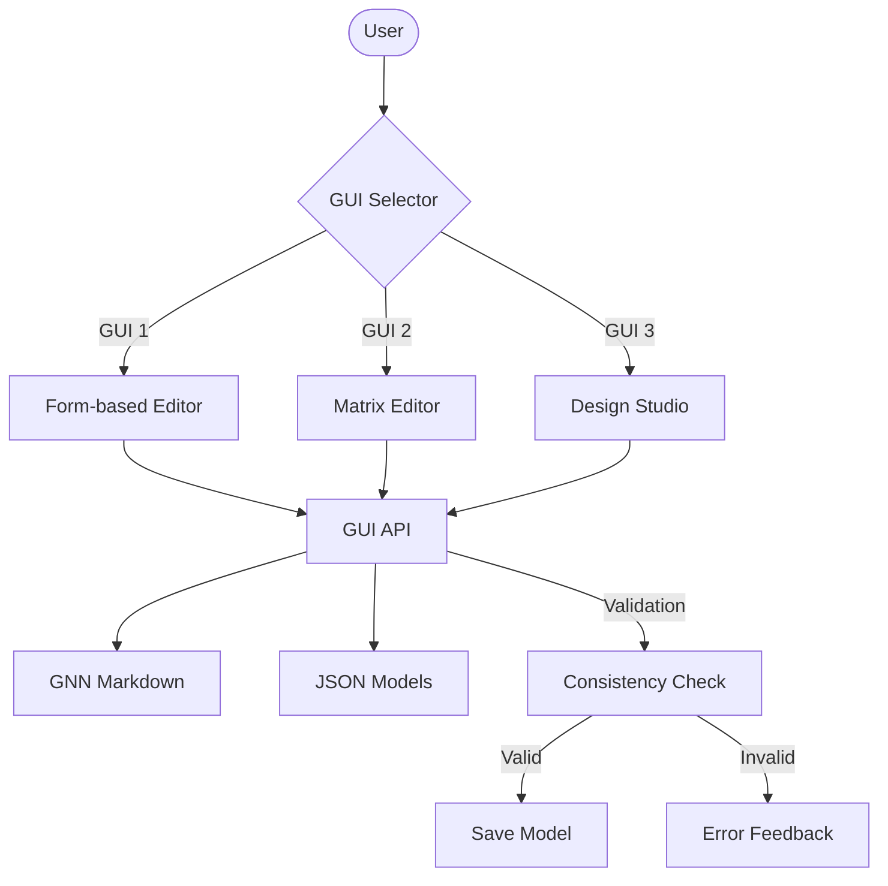

# GUI Module (Interactive GNN Constructors)

## Overview
The GUI module provides **four interactive interfaces** for constructing and editing GNN models: GUI 1, GUI 2, GUI 3, and oxdraw.

### GUI 1: Form-based Interactive GNN Constructor
- Interactive two-pane editor for GNN models
- Left panel (Controls):
  - Components tab: add/remove components, set type (observation/hidden/action/policy), and manage states
  - State Space tab: live list of state-space entries with name, dimensions, type; add/update/remove entries
- Right panel: synchronized plaintext GNN markdown editor
- Edits are immediately reflected in the markdown
- **Access:** http://localhost:7860

### GUI 2: Visual Matrix Editor
- Visual drag-and-drop matrix editing interface
- Interactive heatmaps and plots for matrix visualization
- Real-time GNN markdown generation from visual edits
- POMDP template-based initialization
- Multi-tab interface for A, B, C, D matrices
- Matrix validation and consistency checking
- **Access:** http://localhost:7861

### GUI 3: State Space Design Studio
- Visual state space designer with interactive diagrams
- Ontology term editor for Active Inference concepts
- Connection graph interface with SVG visualization
- Parameter tuning controls (states, observations, actions)
- Real-time GNN export and preview functionality
- Low-dependency HTML/CSS design approach
- **Access:** http://localhost:7862

## Usage
```bash
# Run the default GUI set in headless pipeline mode
python src/gnn/22_gui.py --target-dir input/gnn_files --output-dir output --headless --verbose

# Run specific GUI
python src/gnn/22_gui.py --gui-types gui_1 --target-dir input/gnn_files --output-dir output --interactive --verbose
python src/gnn/22_gui.py --gui-types gui_2 --target-dir input/gnn_files --output-dir output --interactive --verbose
python src/gnn/22_gui.py --gui-types gui_3 --target-dir input/gnn_files --output-dir output --interactive --verbose

# Run multiple specific GUIs
python src/gnn/22_gui.py --gui-types "gui_1,gui_2,gui_3,oxdraw" --target-dir input/gnn_files --output-dir output --headless --verbose
```

- Headless artifact generation is the default. Provision the Python 3.12 GUI
  profile below before passing `--interactive` to launch local web UIs.

## Headless Mode
- If GUIs cannot be launched (or headless=True):
  - GUI-specific status JSON files summarize backend availability and export paths
  - Starter GNN markdown files are created for each GUI
  - Visual matrix data exported as JSON (GUI 2)

## Output Structure
- Standard pipeline mapping: output/22_gui_output/
  - `constructed_model_gui1.md`: GUI 1 output - Form-based constructed GNN model
  - `visual_model_gui2.md`: GUI 2 output - Visual matrix editor GNN model
  - `visual_matrices.json`: GUI 2 output - Matrix data and visualizations
  - `gui_1_status.json` / `gui_2_status.json`: GUI execution status and backend information
  - `designed_model_gui_3.md` / `design_analysis.json` / `design_studio_status.json`: GUI 3 starter model, design analysis, and status
  - `oxdraw_output/`: oxdraw artifacts - `<stem>.mmd` Mermaid exports, `<stem>_from_mermaid.md` round-trip models, `oxdraw_processing_results.json` run results
  - `gui_processing_summary.json`: Overall processing summary with results from all GUIs
  - `navigation.html`: **Comprehensive HTML navigation page** linking to all pipeline outputs

### Navigation.html
The `navigation.html` file provides a centralized navigation interface for all pipeline outputs:
- **Artifact Overview**: Counts of steps with available artifacts and listed files. Standalone navigation is a filesystem census and can contain earlier-run outputs; active pipeline navigation uses the current artifact index and Step 22 model selection. File availability does not establish step completion.
- **Output Sections**: Organized by pipeline step. The first 20 files appear immediately; expand **More files** to access the remainder without JavaScript.
- **Search and File Types**: Offline filters search filenames, paths, and step names, with a live match count and an explicit empty state.
- **File Metadata**: File type, size, full relative path, and URL-encoded links that also work when navigation is generated outside the pipeline output directory.
- **Interactive and Native Outputs**: Includes advanced-visualization/analysis HTML dashboards, CSV data, rendered Stan programs, audio and waveform files, and Oxdraw Mermaid exports.
- **Integration**: Dashboard and comprehensive-report links appear when their artifacts are available to the navigation census.
- **Access**: Open `output/22_gui_output/navigation.html` in a web browser

## Public API
```python
from gnn.gui import (
    # Main processing function
    process_gui,
    # Individual GUI runners
    gui_1,
    gui_2,
    gui_3,
    # oxdraw
    oxdraw_gui,
    get_oxdraw_info,
    # Information functions
    get_available_guis,
    get_gui_1_info,
    get_gui_2_info,
    get_gui_3_info,
    # Navigation generation
    generate_html_navigation,
    # Composability helpers
    normalize_gui_types,
    summarize_gui_results,
    collect_pipeline_outputs,
    MAX_FILES_PER_SECTION,
    PIPELINE_OUTPUT_SECTIONS,
    DEFAULT_GUI_TYPES,
    # GUI 1 utilities
    add_component_to_markdown,
    update_component_states,
    remove_component_from_markdown,
    parse_components_from_markdown,
    parse_state_space_from_markdown,
    add_state_space_entry,
    update_state_space_entry,
    remove_state_space_entry,
)
```

### Individual GUI Functions
```python
gui_1(target_dir: Path, output_dir: Path, logger: Logger, **kwargs) -> Dict[str, Any]
gui_2(target_dir: Path, output_dir: Path, logger: Logger, **kwargs) -> Dict[str, Any]
gui_3(target_dir: Path, output_dir: Path, logger: Logger, **kwargs) -> Dict[str, Any]
```
- Launch specific GUI implementations
- Returns execution results and status information

### process_gui (Main Function)
```python
process_gui(
  target_dir: Path,
  output_dir: Path,
  verbose: bool = False,
  logger: Optional[Logger] = None,  # honored when passed
  **kwargs,  # gui_types (default "gui_1,gui_2"), interactive, open_browser,
             # launch_editor; headless is derived as `not interactive`
) -> bool
```
- Orchestrates execution of multiple GUI implementations
- Returns True if all requested GUIs succeed

### Shared Building Blocks
- `gui/runner.py`: `resolve_output_root`, `load_first_markdown`, and
  `launch_gradio_in_thread` — plumbing shared by all three GUI processors.
- `gui/backend.py`: `detect_gradio_backend` plus atomic artifact writers
  (`write_text_atomically`, `write_json_atomically`); every JSON/markdown
  artifact in this module is written temp-file-then-replace.
- `process_gui(..., logger=...)`: pass a logger to capture GUI logs in your
  own handler; omitted means the `gui.processor` module logger.
- `navigation.html` file names and paths are HTML-escaped at render time, with separate URL encoding for links. Search uses text matching and never interprets artifact names as HTML.

## Architecture

### Modular Structure



### Adding New GUIs
To add a new GUI (e.g., gui_4):
1. Create `gui_4/` subfolder with implementation
2. Add `gui_4()` function in `gui_4/__init__.py`  
3. Update `gui/__init__.py` to import and expose gui_4
4. Update `22_gui.py` to handle gui_4 in processing logic
5. Add port assignment and URL mapping

**Example completed:** GUI 3 (State Space Design Studio) follows this pattern.

## Setup via UV
Install the optional Gradio dependencies explicitly. Use Python 3.12 for
interactive GUI callbacks.

```bash
uv sync --frozen --extra gui --python 3.12
uv run --frozen --no-sync --python 3.12 gnn gui --gui-types gui_1 --interactive
```

## Notes
- Degrades gracefully if Gradio is not installed (headless artifact generation).
- Designed for modularity: logic isolated in `markdown.py`, UI wiring in `ui.py`, thin orchestration in `processor.py`.
- `websocket_bridge.py` defines local-only WebSocket message contracts for reactive GUI synchronization (`tests/gui/test_websocket_bridge.py` covers the contract).


---
## Documentation
- **[README](README.md)**: Module Overview
- **[AGENTS](AGENTS.md)**: Agentic Workflows
- **[SPEC](SPEC.md)**: Architectural Specification
- **[SKILL](SKILL.md)**: Capability API
