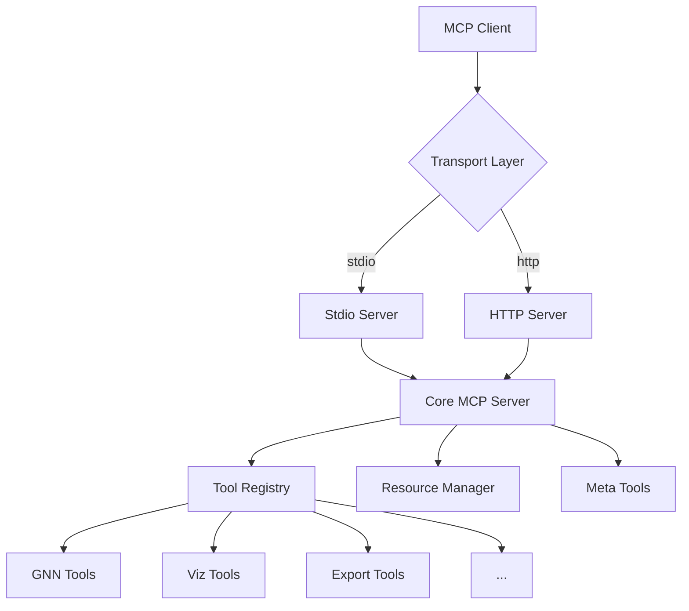

# Model Context Protocol (MCP) Implementation

This directory contains the comprehensive Model Context Protocol (MCP) implementation for the GeneralizedNotationNotation (GNN) project. The MCP server exposes all GNN functionalities as standardized tools that can be accessed by MCP-compatible clients.

## Overview

The GNN MCP implementation provides:
- **Core MCP Server**: JSON-RPC 2.0 compliant server with tool and resource management
- **Multiple Transport Layers**: stdio and HTTP transport support
- **Comprehensive Tool Ecosystem**: Tools from all GNN modules (gnn, type_checker, export, visualization, etc.)
- **Meta-Tools**: Server introspection and diagnostic capabilities
- **CLI Interface**: Command-line access to all MCP functionality
- **Extensible Architecture**: Easy addition of new tools and resources
- **Public exports** (from `gnn.mcp` `__all__`): `MCPRegistry`, `MCPServer`, `get_mcp_instance`, `list_available_tools`, `list_available_resources`, `MCPError`, `MCPToolExecutionError`, `MCPToolNotFoundError`, `MCPValidationError`, `create_mcp_server`, `start_mcp_server`

## Architecture



## Core Components

### 1. MCP Server (`mcp.py`)

The central MCP server implementation that:
- Manages tool and resource registration
- Handles JSON-RPC 2.0 requests
- Provides module discovery and loading
- Implements error handling and logging
- Tracks performance metrics

**Key Features:**
- Dynamic module loading
- Tool and resource registration
- Performance tracking
- Error handling with custom MCP error codes
- Server status monitoring

### 2. Transport Servers

#### stdio Server (`server_stdio.py`)
- Reads JSON-RPC requests from stdin
- Writes responses to stdout
- Multi-threaded architecture for concurrent processing
- Ideal for local process communication

#### HTTP Server (`server_http.py`)
- HTTP-based JSON-RPC server for local orchestration
- Defaults to `127.0.0.1`
- Supports bearer-token auth through `GNN_MCP_TOKEN`
- Supports per-client rate limiting through `GNN_MCP_RATE_LIMIT_PER_MINUTE`
- Exposes only a safe tool allowlist by default; unsafe tools require explicit opt-in
- Denies resource reads by default; expose individual URIs with `GNN_MCP_SAFE_RESOURCES`
- Filters HTTP capability responses to the same safe tool/resource surface

### 3. Command Line Interface (`cli.py`)

Comprehensive CLI for MCP operations:
```bash
# List all capabilities
python -m gnn.mcp.cli list

# Execute a tool
python -m gnn.mcp.cli execute get_pipeline_status

# Get server status
python -m gnn.mcp.cli status

# Start server
python -m gnn.mcp.server_stdio
GNN_MCP_TOKEN=local-dev-token python -m gnn.mcp.cli server --transport http --host 127.0.0.1 --port 8080
```

### 4. Meta-Tools (`meta_mcp.py`)

Server introspection and diagnostic tools:
- `get_mcp_server_capabilities`: Full server capabilities
- `get_mcp_server_status`: Operational status and metrics
- `get_mcp_server_auth_status`: Authentication configuration
- `get_mcp_server_encryption_status`: Encryption status
- `get_mcp_module_info`: Detailed module information
- `get_mcp_tool_categories`: Tools organized by category
- `get_mcp_performance_metrics`: Performance statistics
- `get_mcp_diagnostics`: Diagnostic information and health checks

These meta tools are registered automatically during module discovery
alongside the `sympy_mcp` tools (see `src/gnn/mcp/discovery.py`).

### 5. GNN Processors (`processors.py`)

Enhanced GNN processing functions used by `gnn_root.py` to back the GNN tools:
- `process_gnn_folder`: orchestrates full-folder GNN processing
- `run_gnn_round_trip_tests`: parse → render → re-parse round-trip checks
- `check_cross_format_consistency`: consistency validation across render targets

Implementation lives at `src/gnn/mcp/processors.py`; validators come from `gnn.schema_validator` and `gnn.cross_format_validator`.

## Available Tools by Module

### GNN Module (`src/gnn/mcp/gnn_root.py`)
- GNN file discovery and parsing
- Model structure analysis
- Parameter extraction and validation

### Type Checker (`src/gnn/type_checker/mcp.py`)
- GNN syntax validation
- Resource estimation
- Type consistency checking

### Export (`src/gnn/export/mcp.py`)
- Multi-format export (JSON, XML, GraphML, GEXF, Pickle)
- Network graph export
- Structured data preservation

### Visualization (`src/gnn/visualization/mcp.py`)
- Graph visualization
- Matrix visualization
- Ontology relationship diagrams

### Render (`src/gnn/render/mcp.py`)
- PyMDP code generation
- RxInfer.jl model translation
- Template-based code generation

### Execute (`src/gnn/execute/mcp.py`)
- Script execution
- Result capture and reporting
- Multi-backend support

### LLM (`src/gnn/llm/mcp.py`)
- AI-powered model analysis
- Enhancement suggestions
- Natural language explanations

### Website (`src/gnn/website/mcp.py`)
- HTML website generation
- Report aggregation
- Interactive elements

### SAPF (`src/gnn/audio/sapf/mcp.py`, registered via `src/gnn/audio/mcp.py`)
- Audio generation and sonification
- Model sonification
- Real-time audio processing

### Pipeline (`src/gnn/pipeline/mcp.py`)
- Pipeline step discovery
- Execution monitoring
- Configuration management

### Utils (`src/gnn/utils/mcp/`)
- System diagnostics
- File operations
- Environment validation

## Usage Examples

### 1. Starting the MCP Server

#### stdio Transport (Recommended for local use)
```bash
python -m gnn.mcp.server_stdio
```

#### HTTP Transport (Local JSON-RPC orchestration)
```bash
GNN_MCP_TOKEN=local-dev-token python -m gnn.mcp.cli server --transport http --host 127.0.0.1 --port 8080
```

HTTP tool execution and resource reads are guarded separately. Tool calls are
limited to the safe HTTP allowlist, while `mcp.resource.get` returns an error
unless the requested URI is listed in `GNN_MCP_SAFE_RESOURCES`.
Rate limiting is evaluated before bearer authentication so bad-token traffic is
throttled by the same per-client limit.

### 2. Using the CLI

#### List all available tools
```bash
python -m gnn.mcp.cli --format human list
```

#### Execute a GNN tool
```bash
python -m gnn.mcp.cli execute get_pipeline_status
```

#### Get server status
```bash
python -m gnn.mcp.cli --format json status
```
#### JSON stdout contract (`--format json`)

Place `--format json` before the subcommand, for example
`python -m gnn.mcp.cli --format json status`. Finite commands use this
machine output format. A STDIO server streams protocol messages.
Routine log chatter is suppressed from stdout in this mode; `--verbose` is a
human-mode concern. On failure, the CLI prints a single error document to
stdout and exits with a nonzero code:

```json
{"error": {"operation": "getting tool info", "message": "Tool 'x' not found"}}
```

Note the sibling contract: the `gnn mcp` subcommand of the main `gnn` CLI
emits the standard CLI envelope (via its `--json` flag) instead of this raw
machine payload.

### 3. JSON-RPC API Usage

#### Get server capabilities
```json
{
  "jsonrpc": "2.0",
  "id": 1,
  "method": "mcp.capabilities",
  "params": {}
}
```

#### Execute a tool
```json
{
  "jsonrpc": "2.0",
  "id": 2,
  "method": "mcp.tool.execute",
  "params": {
    "name": "get_gnn_files",
    "params": {
      "target_dir": "doc",
      "recursive": true
    }
  }
}
```

#### Direct tool invocation
```json
{
  "jsonrpc": "2.0",
  "id": 3,
  "method": "get_gnn_files",
  "params": {
    "target_dir": "doc",
    "recursive": true
  }
}
```

## Error Handling

The MCP implementation provides comprehensive error handling:

### Standard JSON-RPC Error Codes
- `-32700`: Parse error
- `-32600`: Invalid Request
- `-32601`: Method not found
- `-32602`: Invalid params
- `-32603`: Internal error

### Custom MCP Error Codes
- `-32000`: MCP-specific errors
- `-32001`: HTTP not-exposed (tool not on the HTTP safe allowlist)
- `-32002`: HTTP not-exposed (resource not on the HTTP safe allowlist)
- `-32003`: Module loading errors
- `-32004`: Performance threshold exceeded
- `-32005`: Rate limit exceeded
- `-32006`: Cache operation failed
- `-32007`: Module discovery failed
- `-32008`: Tool execution timed out (wave-2 MAJ-09; enforced via MCPTool.timeout)

JSON-RPC reserved codes are used where the spec defines them:
- `-32601` (Method not found) is raised for an unknown tool AND for a
  missing resource (`MCPResourceNotFoundError`), not `-32002`.
- `-32602` (Invalid params) covers invalid tool arguments.
- `-32603` (Internal error) covers unhandled execution failures.

### Error Response Format
```json
{
  "jsonrpc": "2.0",
  "id": 1,
  "error": {
    "code": -32001,
    "message": "Tool execution failed",
    "data": {
      "tool": "get_gnn_files",
      "details": "Target directory not found"
    }
  }
}
```

## Performance Monitoring

The MCP server tracks various performance metrics:
- Request count and error rates
- Average execution times per tool
- Module loading statistics
- Server uptime and activity

Access performance data via:
```bash
python -m gnn.mcp.cli execute get_mcp_performance_metrics
```

## Security Considerations

### Transport Security
- **stdio**: Local process only, high security
- **HTTP**: Network accessible, consider HTTPS for production

### Authentication
- HTTP transport requires `Authorization: Bearer <GNN_MCP_TOKEN>` by default.
- Missing or invalid bearer tokens receive `401` before JSON-RPC execution.
- Unauthenticated HTTP is only available for explicit loopback development with
  `GNN_MCP_ALLOW_INSECURE_LOCAL=1`; non-loopback clients still receive `401`.
- Resource reads over HTTP are denied unless the exact URI is included in
  `GNN_MCP_SAFE_RESOURCES`.
- HTTP capability discovery lists only tools and resources exposed by those
  allowlists.
- Use stdio transport for maximum security.

### Recommendations
1. Use stdio transport for local-only access
2. Keep HTTP bound to `127.0.0.1` unless a separate trusted reverse proxy is used
3. Set `GNN_MCP_TOKEN` for every HTTP run
4. Set `GNN_MCP_SAFE_RESOURCES` only for resource URIs that are safe to expose
5. Monitor access logs and performance metrics

## Development and Extension

### Adding New Tools

1. Create or update the module's `mcp.py` file
2. Implement tool functions with proper error handling
3. Register tools using `mcp_instance.register_tool()`
4. Add comprehensive documentation and schemas

### Example Tool Registration
```python
def register_tools(mcp_instance):
    mcp_instance.register_tool(
        name="my_tool",
        func=my_tool_function,
        schema={
            "type": "object",
            "properties": {"param1": {"type": "string"}},
            "required": ["param1"],
        },
        description="Description of my tool",
        module="my_module",
        category="My Category",
        version="1.0.0",
    )
```

### Testing MCP Tools

Use the CLI to test tools:
```bash
# Test tool execution
python -m gnn.mcp.cli execute my_tool --params '{"param1": "value"}'

# Test tool info
python -m gnn.mcp.cli info my_tool
```

## Integration with External Clients

### Claude Desktop
Configure Claude Desktop to use the GNN MCP server:
```json
{
  "mcpServers": {
    "gnn": {
      "command": "/path/to/Generalized_Notation_Notation/.venv/bin/python",
      "args": ["-m", "gnn.mcp.server_stdio"]
    }
  }
}
```

### Other MCP Clients
The server is compatible with any JSON-RPC 2.0 MCP client. Use the HTTP transport for network-based clients or stdio for local integration.

## Troubleshooting

### Common Issues

1. **Module Import Errors**
   - Ensure all dependencies are installed
   - Check Python path configuration
   - Verify module structure

2. **Tool Execution Failures**
   - Check tool parameters and schemas
   - Review error messages and logs
   - Validate input data

3. **Server Connection Issues**
   - Verify transport configuration
   - Check firewall settings for HTTP transport
   - Ensure proper permissions

### Debug Mode

Enable verbose logging:
```bash
python -m gnn.mcp.cli --verbose list
```

### Log Files

Check log files in the output directory:
```bash
ls -la output/logs/
```

## Contributing

When contributing to the MCP implementation:

1. Follow the established patterns for tool registration
2. Add comprehensive error handling
3. Include proper documentation and schemas
4. Test with both stdio and HTTP transports
5. Update this README for new features

## References

- [Model Context Protocol Specification](https://modelcontextprotocol.io/)
- [JSON-RPC 2.0 Specification](https://www.jsonrpc.org/specification)
- **[Comprehensive MCP Documentation](MCP_DOCUMENTATION.md)** — Full implementation guide and live audit commands for the registered tool surface
- [GNN Project Documentation](../../../docs/)
- [MCP Integration Guide](../../../docs/mcp/gnn_mcp_model_context_protocol.md)
- Project overview: ../../../README.md
- Comprehensive docs: ../../../DOCS.md
- Pipeline details (Step 22): ../../../docs/pipeline/README.md

---
## Documentation
- **[README](README.md)**: Module Overview
- **[AGENTS](AGENTS.md)**: Agentic Workflows
- **[SPEC](SPEC.md)**: Architectural Specification
- **[SKILL](SKILL.md)**: Capability API


### Transport reliability

HTTP, stdio, and core responses use `jsonrpc.py` envelope builders. Invalid
request structures produce `-32600`; non-object parameters produce `-32602`;
parse errors produce `-32700`. Missing request IDs identify notifications:
handlers execute valid notifications without JSON-RPC replies (HTTP returns
204 with no body). An explicit `id: null` still receives a response with a null
ID. HTTP authentication, rate limits, and tool/resource allowlists remain in
force for notifications as well as ordinary requests.

CI runs functional MCP registration/execution, transport regressions, and
capability contracts explicitly on Python 3.12 pull requests; the broader test
job's MCP marker exclusion does not exclude this gate. Registry availability
and absent optional dependencies are reported explicitly; tool counts alone do
not establish functional health.
