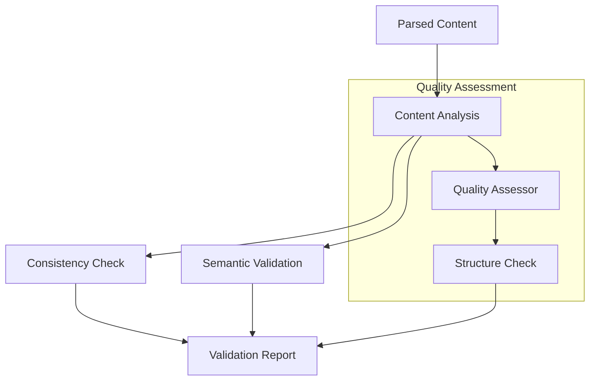
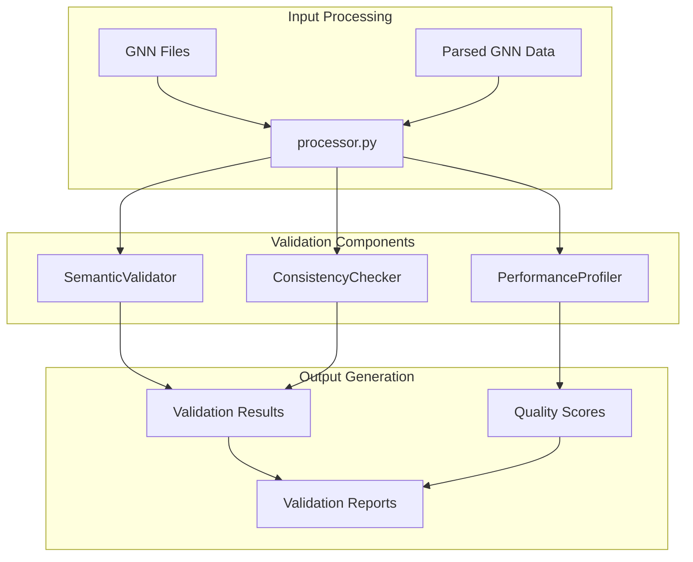
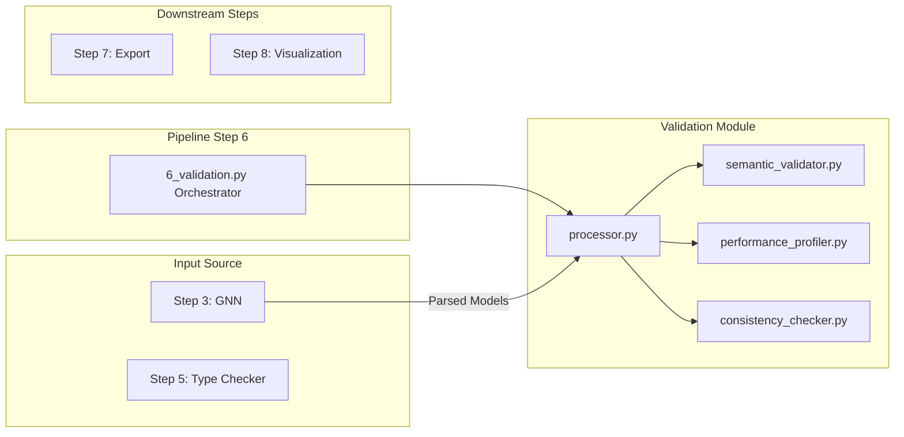

# Validation Module

This module provides comprehensive validation capabilities for GNN models, including consistency checking, semantic validation, and quality assessment.

## Source-bound numerical witnesses

`semantic_witness.py` builds and replays `gnn-semantic-witness-v2` records.
The CLI bounds source inputs to 1 MiB, result/program artifacts to 16 MiB each,
and serialized receipts to 96 MiB before writing or printing their contents.
Verification applies the same receipt limit. JSON escaping and receipt metadata
count toward that limit, so individually admitted artifacts can still exceed the
combined receipt budget and receive an explicit refusal.
`witness_source.py` independently reads the explicitly declared restricted
source subset and implements bounded finite path enumeration and joint-Gaussian
conditioning. It imports no GNN extractor or renderer. The
[E4 contract](../../../docs/development/remaining_roadmap_contracts.md#e4-replayable-semantic-evidence-v2)
owns admitted models, bounds, tolerances and evidence limits.

```bash
gnn witness model.md --results simulation_results.json --program model.py --output witness.json --json
gnn witness --verify witness.json --json
```

The source needs the versioned `NumericalWitness` declaration; ordinary GNN
models without it refuse this narrow operation. Source labels are conditional
axis names, not authenticated native labels. Missing or conflicting native
metadata prevents agreement. Whole-receipt replay recomputes references from raw
bytes and preserves failed, refused and unavailable outcomes. A replay-valid
failed record is still unsuccessful for CLI acceptance. Neither file hashes nor
matching posterior arrays authenticate execution or establish a Lean proof.

For standalone Step 20 browsing, put records under
`output/16_analysis_output/semantic_witnesses/`. An active run additionally
requires its owned artifact inventory and selected source identities; directory
presence alone cannot supply current evidence.

## Module Structure

```
src/gnn/validation/
├── __init__.py                    # Module exports and thin process_validation facade
├── README.md                      # This documentation
├── AGENTS.md                      # Agent scaffolding documentation
├── SPEC.md                        # Module specification
├── consistency_checker.py         # Consistency checking (naming, style, structure, references)
├── semantic_validator.py          # Semantic validation (structure, state space, connections, math)
├── simple.py                      # Dependency-free basic validator: marker/extension sniffing
├── orientation.py                 # B-tensor orientation diagnostic (canonical vs textbook POMDP)
├── performance_profiler.py        # Performance profiling (complexity, memory, parallelization)
├── structure.py                   # Shared helpers (content extraction, cycle detection, score clamping)
├── workflow.py                    # Step-6 directory workflow (stage runner, receipts, accumulation)
└── mcp.py                         # Model Context Protocol integration
```

### Validation Process



### Validation Architecture



### Module Integration Flow



## Core Components

### Orchestrator Function

#### `process_validation(target_dir: Path, output_dir: Path, verbose: bool = False, **kwargs) -> bool`

Main pipeline orchestrator (called by `src/gnn/6_validation.py`). Reads GNN results JSON from step 3, then runs the three validators plus the B-tensor orientation diagnostic on each parsed file.

**kwargs:** `validation_level` (semantic depth: `basic`/`standard`/`strict`/`research`; default `standard`), `strict` (shorthand for `validation_level="strict"`, wired to the orchestrator's `--strict` flag), `transpose_b` (opt-in canonical B-tensor transposition for the orientation stage; textbook row-stochastic tensors are transposed in memory and recorded in the receipt, default warnings-only), `strict_probabilities` (opt-in numeric probability validation through the strict extraction contract). `logger`, `recursive`, and `profile` are accepted for the pipeline-template contract and do not alter behavior.

**Workflow:**

1. Loads `gnn_processing_results.json` from step 3 output directory
2. For each parsed file, runs `process_semantic_validation()`, `profile_performance()`, `check_consistency()`, and — when the `orientation` service is injected, as `process_validation` does by default — `check_b_orientation()` (B-tensor orientation diagnostic, warnings only)
3. Calculates average scores and writes `validation_results.json` and `validation_summary.json`

**Returns:** `bool` — `True` only when the current manifest contains at least one file and every current file succeeds. Semantic `valid: false`, parser failure, missing parsed artifacts, and operational recovery all fail the current pass. Historical successes cannot change this verdict.

**Receipt scope:** optional `run_id` identifies deliberate accumulation across multiple manifests. Without it, the manifest's `run_id`, then its `timestamp`, identifies the run. Manifests with neither field are unbound records scoped to the output
directory; callers reusing that directory across independent runs must supply `run_id`. Changing the run or `validation_level` starts a fresh scope. Repeating a source path replaces its previous entry, and summaries are recalculated from distinct entries rather than incremented. Each entry includes `receipt_key` and `input_identity` derived from the source path, source/parsed bytes, parser outcome, and run/configuration.

`validation_results.json` retains aggregate `summary` and adds `current_summary` for the current pass. `validation_summary.json` remains the aggregate summary for compatible consumers. Both files are replaced atomically individually; they are not a multi-file transaction.

**Location:** thin binding in `__init__.py`; implementation in `workflow.py` (`validate_directory` with injected `StageServices`).

### SemanticValidator (`semantic_validator.py`)

#### `SemanticValidator(validation_level: str = "standard")`

Rule-based validator with 7 validation rules across 4 levels (basic, standard, strict, research).

**Validation Rules:**

- `_validate_basic_structure` (level 1) — ModelName, StateSpaceBlock presence
- `_validate_state_space_definitions` (level 1) — dimension parsing
- `_validate_connection_integrity` (level 2) — source/target refs
- `_validate_mathematical_consistency` (level 2) — matrix dims, probability sums
- `_validate_active_inference_principles` (level 3) — FEP terms
- `_validate_causal_relationships` (level 3) — cycle detection with exact membership (Tarjan SCC)
- `_validate_advanced_mathematical_properties` (level 4) — KL divergence

#### `process_semantic_validation(model_data, **kwargs) -> Dict[str, Any]`

Entry point — accepts file path, Path, or dict. Returns `{valid, errors, warnings, semantic_score}`.

#### `validate_content(content, validation_level: str = "standard") -> Dict[str, Any]`

Validate raw GNN content text without file I/O — the in-memory companion to
`process_semantic_validation`. Returns the same receipt shape with
`file_path`/`file_name` set to `"unknown"`. File, raw-section, and structured-model inputs share this semantic receipt. Reconstruction preserves all connection endpoints and annotations. Canonical Markdown checks reject undeclared connection endpoints (standard and above) and non-positive numeric dimensions; symbolic dimensions remain supported and comments are ignored.

CLI JSON and the validation MCP file tool expose this receipt under `semantic`. CLI keeps its existing exit policy: findings return 2, or 1 with `--strict`. MCP keeps transport success separate from model validity (`success: true`, `is_valid: false` for a completed validation of an invalid model).

### PerformanceProfiler (`performance_profiler.py`)

#### `PerformanceProfiler()`

Estimates computational complexity, memory usage, and parallelization potential from GNN content.

**Metrics Calculated:**

- State block count, dimension statistics, estimated memory (MB)
- Computational complexity class (O(1) through O(n³)+)
- Bottleneck block identification
- Parallelization potential and GPU/distributed amenability

#### `profile_performance(model_path) -> Dict[str, Any]`

Entry point — accepts file path, Path, or dict. Returns `{metrics, warnings, performance_score}` with `recovery: False` on success and a uniform error receipt (`{status: "error", ..., performance_score: 0.0, recovery: True}`) on failure.

### ConsistencyChecker (`consistency_checker.py`)

#### `ConsistencyChecker()`

Checks naming conventions, style consistency, structural integrity, and reference consistency.

**Checks Performed:**

- `_check_naming_conventions` — camelCase vs snake_case mix, duplicates, short names
- `_check_style_consistency` — indentation patterns, block formatting, field ordering
- `_check_structural_integrity` — balanced braces, empty blocks, required fields
- `_check_reference_consistency` — invalid refs, isolated blocks, circular dependencies

#### `check_consistency(model_data) -> Dict[str, Any]`

Entry point — accepts file path, Path, or dict. Returns `{consistent, warnings, consistency_score}`.

## Usage Examples

### Pipeline Orchestration

```python
from gnn.validation import process_validation
from pathlib import Path

# Run full validation pipeline (requires step 3 output)
success = process_validation(
    target_dir=Path("models/"),
    output_dir=Path("output/6_validation_output/"),
    verbose=True,
)
print(f"Validation {'succeeded' if success else 'failed'}")
```

### Semantic Validation

```python
from gnn.validation import process_semantic_validation

# Validate from file path
result = process_semantic_validation("model.gnn", validation_level="strict")
print(f"Valid: {result['valid']}, Score: {result['semantic_score']:.2f}")
print(f"Errors: {result['errors']}")
print(f"Warnings: {result['warnings']}")

# Validate from dict (e.g., parsed GNN data)
result = process_semantic_validation(
    {"raw_sections": {"ModelName": "Test", "StateSpaceBlock": "..."}}
)
```

### Performance Profiling

```python
from gnn.validation import profile_performance

result = profile_performance("model.gnn")
print(f"Memory estimate: {result['metrics']['estimated_memory_mb']:.2f} MB")
print(
    f"Complexity: {result['metrics']['computational_complexity']['complexity_class']}"
)
print(f"Score: {result['performance_score']:.2f}")
```

### Consistency Checking

```python
from gnn.validation import check_consistency

result = check_consistency("model.gnn")
print(f"Consistent: {result['consistent']}, Score: {result['consistency_score']:.2f}")
print(f"Warnings: {result['warnings']}")
```

### Standalone Class Usage

```python
from gnn.validation import SemanticValidator, ConsistencyChecker, PerformanceProfiler

# Direct class usage with content strings
validator = SemanticValidator(validation_level="research")
result = validator.validate(gnn_content)  # Returns {is_valid, errors, warnings}

checker = ConsistencyChecker()
result = checker.check(gnn_content)  # Returns {is_consistent, warnings, checks}

profiler = PerformanceProfiler()
result = profiler.profile(gnn_content)  # Returns {metrics, warnings}
```

## Integration with Pipeline

### Pipeline Step 6: Validation Processing

The `process_validation()` orchestrator is called by `src/gnn/6_validation.py`. It:

1. Reads `gnn_processing_results.json` from step 3 output
2. Iterates over each successfully parsed file
3. Runs semantic validation, performance profiling, and consistency checking
4. Writes results to the step 6 output directory

### Output Structure

```
output/6_validation_output/
├── validation_results.json        # Per-file validation details
└── validation_summary.json        # Aggregated scores and counts
```


## Configuration

There is no module-level configuration file. `SemanticValidator` takes `validation_level` (`basic`, `standard`, `strict`, `research`); the `process_validation()` orchestrator runs semantic validation, performance profiling, and consistency checking with their defaults.

## Error Handling

All entry-point functions use try/except blocks internally and return error dicts with `recovery: True` instead of raising exceptions:

```python
result = process_semantic_validation("nonexistent.gnn")
if result.get("recovery"):
    print(f"Error: {result['error']}")
else:
    print(f"Valid: {result['valid']}")
```

The `process_validation()` orchestrator catches all exceptions per-file, logs errors, and continues processing remaining files.


## Testing

Validation module tests are located in `tests/validation/` (`test_validation_overall.py`, `test_consistency_contract.py`, `test_validation_public_api.py`, `test_workflow_contracts.py`, `test_b_orientation.py`) and cover:

- `process_semantic_validation()` with file path and dict inputs
- `profile_performance()` with file path and dict inputs
- `check_consistency()` with file path and dict inputs
- `process_validation()` orchestrator integration
- Module import and feature flag verification

## Dependencies

### Required Dependencies

- **pathlib**: Path handling
- **json**: JSON data handling
- **logging**: Logging functionality
- **typing**: Type hints and annotations

### Optional Dependencies

None. The validators use only the standard library (`pathlib`, `json`, `logging`, `re`, `typing`).


## Troubleshooting

### Common Issues

#### 1. Validation Failures

```
Error: Validation failed - invalid content format
Solution: Validate content format and structure
```

#### 2. Consistency Issues

```
Error: Consistency checking failed - ambiguous relationships
Solution: Clarify relationships and dependencies
```

#### 3. Quality Issues

```
Error: Quality assessment failed - insufficient data
Solution: Provide complete model information for assessment
```

#### 4. Semantic Issues

```
Error: Semantic validation failed - unclear meaning
Solution: Clarify semantic meaning and context
```

### Debug Output

```python
# Verbose mode logs per-file details at DEBUG level
results = process_validation(target_dir, output_dir, verbose=True)
```

## Summary

The Validation module provides comprehensive validation capabilities for GNN models, including consistency checking, semantic validation, and quality assessment. The module ensures reliable validation, proper error detection, and optimal quality assessment to support Active Inference research and development.

## License and Citation

This module is part of the GeneralizedNotationNotation project. See the main repository for license and citation information.

## References

- Project overview: ../../../README.md
- Comprehensive docs: ../../../DOCS.md
- Architecture guide: ../../../ARCHITECTURE.md
- Pipeline details: ../../../docs/pipeline/README.md


---
## Documentation
- **[README](README.md)**: Module Overview
- **[AGENTS](AGENTS.md)**: Agentic Workflows
- **[SPEC](SPEC.md)**: Architectural Specification
- **[SKILL](SKILL.md)**: Capability API
