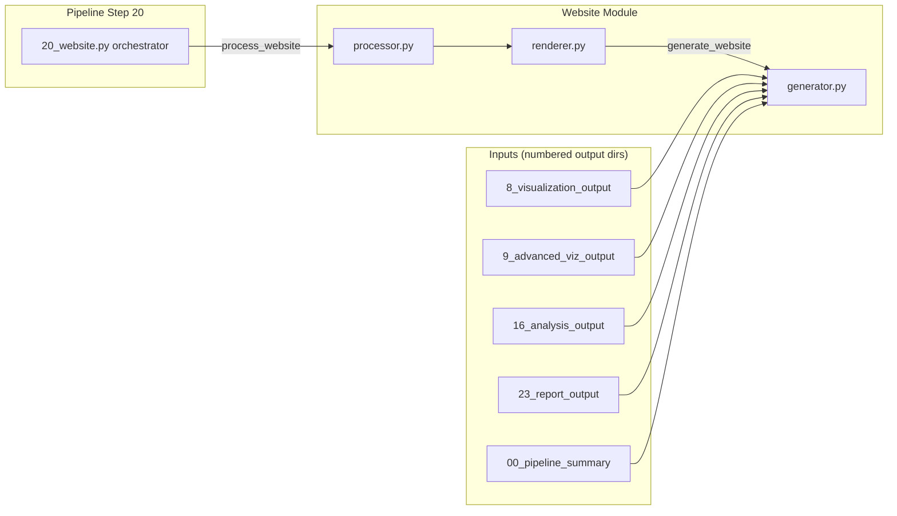

# Website Module

Static HTML website generation for the GNN pipeline: produces a premium,
dark-mode, multi-page site from pipeline artifacts (visualizations, reports,
analysis results, GNN source files, execution summaries, and the MCP tool
registry).

## Module Structure

```
src/gnn/website/
├── __init__.py        # Public exports (see API below)
├── processor.py       # Thin facade re-exporting renderer.process_website
├── renderer.py        # process_website + embed_* helpers + get_module_info
├── collection.py      # collect_website_data + private artifact collectors
├── generator.py       # Site orchestration and dataset-specific page content
├── evidence.py        # Read-only recorded numerical/formal evidence in analysis.html
├── templates.py       # Offline page shell, styles, search script and escaping
├── inspection.py      # inspect_website / list_website_pages (pure site queries)
└── mcp.py             # MCP tool registration (6 tools)
```

No template engine or external static assets are needed. The presentation owner
[`templates.py`](templates.py) composes inline CSS/HTML with the live page
catalogue; it imports no collectors or publication code. The generator builds
dataset-specific content, isolates page failures and writes the resulting site.

### Pipeline Integration



The site aggregates Step 8/9 visualizations, Step 16 analysis JSON, and
reports from every numbered output dir under the `pipeline_output_root`
(defaults to `output_dir.parent`). Active runs use the matching
`00_pipeline_summary/current_summary.json` and owned artifact inventory;
standalone browsing uses `pipeline_execution_summary.json`. Missing current
evidence leaves steps pending. Directory discovery is a standalone fallback.
Running, warning, skipped and failed steps retain distinct badges.

Every page provides keyboard focus indicators, a skip link, reduced-motion
styles and a native mobile navigation disclosure that also works without
JavaScript. The model search has an explicit label and announces result counts.

## API

### `process_website(target_dir: Path, output_dir: Path, verbose: bool = False, pipeline_output_root: Path | None = None, **kwargs) -> bool`

Top-level entry point called by `src/gnn/20_website.py`. Creates `output_dir`,
delegates to `generate_website`, and writes a minimal `website_results.json`
manifest. Returns `True` on success.

```python
from gnn.website import process_website
from pathlib import Path

success = process_website(
    target_dir=Path("output"),
    output_dir=Path("output/20_website_output"),
    verbose=True,
)
```

The result manifest (`website_results.json`) is written atomically with the
same temp-file-plus-rename helper the pages use.

### `generate_website(logger, input_dir, output_dir, *, pipeline_output_root=None) -> dict`

Module-level convenience in `generator.py`. Returns a result dict
`{success, pages_created, errors, warnings}` (plus `model_pages_created` /
`model_pages` when per-model pages were generated). Raises nothing — failures are
reported in `errors`.

### `WebsiteGenerator`

Class backing `generate_website`. `generate_website(website_data)` builds the
seven pages listed under Output, one detail page per parsed model under
`model/<slug>.html` — the model's FULL source (no truncation; the
3000-character cap stays only on the aggregate GNN Files listing rows) with
variables/edges tables and embedded visualization assets — plus
`search-index.json`. `create_pages(output_dir, data)` is an
alternate entry point that performs the same build.

Model pages retain associated images and interactive HTML visualizations.
Artifact attachment uses exact model identity when provenance is available;
standalone sites retain the filename matching convention. Interactive artifacts
have an open link and a lazy, sandboxed preview. Viewers that need access blocked
by the embedded sandbox can be opened through the adjacent link.

The dashboard artifact browser links every admitted file relative to the actual
website directory, including filenames with spaces or URL punctuation. The first
ten files remain visible and a native disclosure lists the rest. During a bound
pipeline run, the browser lists only recorded current artifacts for the selected
models. Standalone generation labels its listing as a filesystem census; file
presence does not establish a successful step outcome.

### Recorded numerical and formal evidence

`analysis.html` presents `gnn-semantic-witness-v2` receipts,
`fep-semantic-witness-audit-v1` wrappers and historical
`gnn-independent-numerical-witness-v1` records alongside existing Step 16
cross-framework comparisons. The separate `fep-gnn-semantic-native-v1` adapter
presents retained Lean compiler receipts as global formal artifacts, without
claiming a source-model numerical binding. Text and reported-status filters work offline.
Each entry retains per-quantity outcomes, absolute/relative differences and
tolerances, refusal/unavailable reasons, scientific assumptions, reference and
candidate records, artifact/runtime provenance and the complete saved receipt.
Provenance shows retained body byte counts and digests; source, result and
program text remain complete in the saved-receipt disclosure. JSON text nodes
escape markup characters while preserving copyable JSON quotes. This avoids
serializing and embedding the same large artifact bodies twice.
V2 and wrapped-v2 entries also offer a bounded trace explorer when their recorded
identities and array metadata permit aligned display. Select a source state axis,
posterior means/probabilities or covariance diagonal variance, then inspect the
reference/candidate values or their display residual. Failed numerical quantities
remain explicitly diagnostic. Refused/unavailable identities, inconsistent
metadata and malformed or oversized arrays produce no plot. The explorer admits
at most eight conditioning prefixes and four state axes, uses inline SVG and
includes a complete value table. Variance is distinct from mean; no confidence
bands or verification conclusions are inferred.
FEP formal references and unmatched assumptions remain inspectable separately
from replay, Lean compilation, execution and pair-custody fields.

The viewer displays unverified saved receipts. It does not replay computations,
check source hashes or establish native execution, Lean compilation, theorem
proof or universal equivalence. A reported `comparable` pair retains its
individual quantity failures. A saved success flag is displayed as reported,
with the same explicit boundary. The existing Step 16 collector retains
current-run and selected-model filtering; pure-dict callers can supply the same
records through the `analysis` dataset without running collectors.
For a bound run, recognized witness receipts must declare a source SHA-256
matching one of Step 20's selected original models. V2 receipts and the nested
GNN witness in a FEP audit additionally require retained source UTF-8 bytes whose
computed hash matches that identity; missing, inconsistent or unselected source
identities are excluded even when their neutrally named receipt file is current.
This selection check does not validate the recorded numerical or proof outcomes.
An owned global native compiler receipt remains separate from model-source
admission. Its table distinguishes positive theorem compilation from the expected
rejection of false claims; an accepted negative control is a recorded rejection,
not a failed positive theorem. Compiler/axiom output, errors, warnings, source
hashes, `has_sorry` and toolchain identities remain inspectable. Its fixed scope is
finite-weight normalization and scalar arbitrary-H prior measurement algebra;
it does not establish GNN parsing/execution, matrix Gaussian conditioning or
universal translation correctness.

### Recorded resources and bounded rendering measurements

When the pipeline summary supplies `execution_resources`, the index displays
recorded logical CPUs and requested file, step and execution worker limits.
A null step limit means automatic selection. `parallel_tiers` rows separately
show recorded tier concurrency and estimated memory. Missing fields stay absent;
configuration limits do not establish actual file-worker use or speedup.

A local 2026-10-23 presentation measurement used the retained 15 JSON receipts
(357,355 input bytes) and a deterministic 150-entry repetition. Seven warmed
render samples excluded the separate profiling and allocation measurements;
three complete seven-page writes were measured separately. On CPython 3.15.1,
the 15-entry evidence render median fell from 5.48 ms to 3.62 ms and the
150-entry median from 52.61 ms to 36.63 ms. HTML fell from 970,280 to 659,913
bytes for 15 entries; traced peak allocations fell from 5.73 MB to 3.88 MB.
CPython 3.14.9 produced identical HTML sizes, with render medians changing from
5.19 ms to 3.71 ms and 53.37 ms to 38.72 ms respectively. These are bounded
local presentation measurements, without a pipeline, native-inference or
worker-scaling claim; 3.15 profiling does not change the supported runtime
matrix. Input/source hashes, interpreter identities, individual samples,
profiles and the measurement driver are retained under
`out/e5-website-performance-2026-10-23/` in this workspace.

### Embedding helpers (`renderer.py`)

All return `bool`:

- `embed_image(image_path, output_file)`
- `embed_markdown_file(md_path, output_file)`
- `embed_text_file(text_path, output_file)`
- `embed_json_file(json_path, output_file)`
- `embed_html_file(html_path, output_file)`
- `generate_html_report(content, output_file)`

### Introspection / data collection

- `get_module_info() -> dict` — module features and supported file types.
- `get_supported_file_types() -> list[str]` — flat list of extensions.
- `validate_website_config(config: dict | str) -> bool | dict` — light
  validation helper (accepts a dict or a simple string for tests).
- `collect_website_data(pipeline_output_root, input_dir, assets_dir, *, output_dir=None, user_data=None) -> dict`
  — pure aggregation of all page inputs; step statuses come from
  the current summary for an active run, or
  `00_pipeline_summary/pipeline_execution_summary.json` for standalone browsing
  (directory fallback only in standalone mode); MCP page data is sourced from the
  step-21 artifacts (`21_mcp_output/mcp_processing_summary.json` and
  `registered_tools.json`), degrading to a truthful empty state when absent.
- `get_pipeline_steps() -> tuple[StepInfo, ...]` — the immutable 25-step
  catalogue derived from `gnn.pipeline.step_registry.STEPS`
  (`StepInfo(number, name, description)` + `script_name` display property
  matching the real orchestrator scripts); `PIPELINE_STEPS` is the same
  tuple as a constant.
- `steps.py` — the leaf step-catalogue module: `StepInfo` (frozen
  `number`/`name`/`description` dataclass + `script_name`/`output_dir_name`
  display properties), `PIPELINE_STEPS` (the 25-step tuple derived from
  `gnn.pipeline.step_registry.STEPS`), and `get_pipeline_steps()` live
  there; `generator.py` re-exports all three (the `gnn.website` package
  contract is unchanged) while `collection.py` imports the leaf directly —
  the `collection → steps` cycle direction that broke the former
  generator↔collection import cycle.
- `website_data_from_dict(user_data, *, output_dir=None) -> dict` — the
  pure, dict-driven composition seam: builds the full generator data dict
  from a plain user dict with NO disk access (missing keys take the
  collectors' exact empty defaults, extra keys preserved verbatim;
  `PURE_DICT_KEYS` is the known-dataset key set). Pair with
  `WebsiteGenerator.generate_website(website_data, *, filesystem=False)`,
  which skips `_collect_all_data` and renders purely from the caller dict;
  the default `filesystem=True` path and the module-level
  `generate_website(logger, input_dir, output_dir)` convenience are
  unchanged.
- `read_website_page(directory, page_name, max_chars=20000) -> dict`
  — capped read of one catalogue page's HTML from a generated site
  (`"\n\n… [truncated]"` marker when capped; graceful `success: False` +
  `error` for an unknown page key, a missing directory, or a missing page
  file). Shared implementation behind the `get_website_page` MCP tool.
- `SITE_PAGES` / `page_names()` / `is_valid_page(name)` / `page_count()` (from
  `pages.py`) — the one frozen, ordered catalogue of the site's pages
  (`PageSpec(name, title, builder, description, icon)` + `filename`); the
  builders map, sidebar navigation, and `KEY_PAGES` all derive from it.

## Output

`generate_website` writes the seven HTML pages plus one detail page per parsed
model under `model/<slug>.html` and `search-index.json`, then `website_results.json`
(keys: `success`, `pages_created`, `pages`, `errors`, `warnings`,
`generated_at`, plus `model_pages_created` and `model_pages` — site-root-relative
filenames — for the per-model pages). Every generated page (site pages and
model pages) carries a breadcrumb nav (`Home › <section>`; model pages:
`Home › GNN Files › <Model Name>`; index: a single `Home` crumb). Pages are
written independently and atomically: one bad page is recorded in `errors`
while the rest of the site stays intact, and `success` is `True` only when no
errors occurred. All pipeline-derived values are HTML-escaped:

```
output/20_website_output/
├── index.html          # Pipeline dashboard with step cards
├── pipeline.html       # Full 25-step pipeline status table
├── gnn_files.html      # GNN source file browser + client-side search box
├── analysis.html       # Statistical analysis results
├── visualization.html  # Gallery of generated visualizations
├── reports.html        # JSON/text report viewer
├── mcp.html            # MCP tools registry across all modules
├── model/              # One detail page per parsed model (model/<slug>.html; full source, no truncation)
├── search-index.json   # Client-side search index (title/url/snippet per emitted page)
├── website_results.json
└── assets/
```

## CLI

```bash
# Run only the website step
python src/gnn/20_website.py --target-dir input/gnn_files --output-dir output --verbose

# As part of the full pipeline
python src/gnn/main.py --only-steps 20 --verbose
```


## Dependencies

Stdlib only (`logging`, `pathlib`, `json`, `shutil`, `datetime`, `html`).
No optional pip extra is required to import or run this module — Jinja2,
Markdown, and Bleach are **not** used. The orchestrator relies on the core
`gnn.utils.pipeline_orchestration.pipeline_template` utility.

## MCP Tools

Registered in `mcp.py` (`register_tools`):

- `process_website`
- `build_website_from_pipeline_output`
- `get_website_status`
- `list_generated_website_pages`
- `get_website_module_info`
- `get_website_page`

## Testing

```bash
uv run --extra dev python -m pytest tests/website/ \
    --cov=src/gnn/website --cov-report=term-missing
```
Test files: `test_website_overall.py`, `test_website_public_api.py`,
`test_website_pages.py`, `test_website_index_dashboard.py`,
`test_website_generator_units.py`, `test_website_collection.py`,
`test_website_inspection.py`, `test_website_mcp_page.py`,
`test_website_gui_crosslinks.py`, `test_website_model_pages.py`.

## Troubleshooting

### Website generation fails (no HTML written)

- Confirm prior steps produced numbered output dirs under
  `pipeline_output_root` (defaults to `output_dir.parent`).
- Run with `--verbose` for per-page error logging.
- `process_website` returns `False` and logs the failing reason if
  `target_dir` does not exist.

### Embedded content missing

`embed_*` helpers return `False` when the source file is absent or unreadable;
check return values and that paths are absolute or resolvable from the cwd.

---
## Documentation
- **[README](README.md)**: Module Overview
- **[AGENTS](AGENTS.md)**: Agentic Workflows
- **[SPEC](SPEC.md)**: Architectural Specification
- **[SKILL](SKILL.md)**: Capability API

The serving thread retains the bound HTTP server until it exits. Immediate
shutdown can clear instance state while that thread starts; the retained handle
lets shutdown finish and release the listening port in either startup order.
